> Source: [Chapter 4 Tutorial 3_ Data Visualisation - Numeric variables _ QDA Lab Workbook.html](../Tutorial/Tutorial_3/Chapter%204%20Tutorial%203_%20Data%20Visualisation%20-%20Numeric%20variables%20_%20QDA%20Lab%20Workbook.html) · [Original workbook page](https://qdaworkbook.netlify.app/tutorial-3-data-visualisation-%2D-numeric-variables)

<span id="tutorial-3-data-visualisation---numeric-variables"></span>

# 4 Tutorial 3: Data Visualisation - Numeric variables

**Important: We are going to move from using R Scripts to using something called R Markdown. Your Tutors will give you a short introduction to this first.**

In **Lab** **Tutorial 3**, we will be looking at visualising our data using the `ggplot2` package from the `tidyverse`.

This time we’re going to use RMarkdown. So you will need to open up a new RMarkdown document, *delete out the unnecessary boilerplate text* - **except for the setup chunk**…. and save your file. **Your tutors will help you with this.**

Because we set up an R project at the outset (in *Lab Tutorial 1*), this will automatically save into our project folder: so we do not need to worry about where it will be saved or its file path. When saving, call it something sensible you will remember e.g. Lab Tutorial 3.

An important point: RMarkdown is its own self-enclosed and self-contained space - see it like its own app. We are starting from scratch or with a blank slate in effect. And therefore we will need to recreate everything we have done previously. For example, although we created listings in Tutorial 1 and we can see it in the Environment (Window Pane 3), your new RMarkdown document cannot access this. So we need to create it all over again. We’ll also need to load the `tidyverse` again too. OK, so let’s recreate our work so far into our RMarkdown document and then we can get started.

<span id="using-the-setup-chunk"></span>

### 4.0.1 **1. Using the setup chunk**

We will use the setup chunk to get set up. You will notice that we can do that ‘quietly’ in the background because the setup chunk has the following argument: `include = FALSE.`This means we don’t see any of the results or output from loading our libraries or reading in our data etc. All our background work gets done in the setup chunk therefore. This will be the same for your data project.

OK so , we’ll need to do the following:

1.  Load in our libraries (here just the tidyverse)
2.  Read in our data (as we did in Lab Tutorial 1)
3.  Recreate any changes we made to our data (as we did in Lab Tutorials 1-2)

Let’s follow these steps then: type in the following code or copy and paste it from the previous Lab Tutorials:

``` r
# 1. Load in our libraries (here just the tidyverse)
library(tidyverse)

# 2.  Read in our data (as we did in Lab Tutorial 1)
listings <- read_csv("listings_edinburgh.csv")
```

``` text
## Rows: 14014 Columns: 10
## ── Column specification ──────────────────────────────────────────────────────────────────────────
## Delimiter: ","
## chr (4): name, neighbourhood_cleansed, property_type, room_type
## dbl (6): accommodates, bathrooms, bedrooms, beds, price, review_scores_rating
## 
## ℹ Use `spec()` to retrieve the full column specification for this data.
## ℹ Specify the column types or set `show_col_types = FALSE` to quiet this message.
```

``` r
# Note: # remember to check your file path is the same as mine above.

# 3. changes from Tutorials 1-2:

# Tutorial 1: coerce room_type from character to factor
listings <- mutate(listings,
                   room_type = factor(room_type),
                   property_type = factor(property_type)) # one line of code now


# Tutorial 2: filter out any extreme or questionable values
listings <- filter(listings,
                   price >= 25, price <= 1000, bathrooms <= 5) %>%
  drop_na(price, bedrooms, bathrooms) # and drop any missing (na) values
```

Let’s add a new chunk just to do a quick check everything looks OK:

``` r
glimpse(listings) # check our variable data types
```

``` text
## Rows: 13,647
## Columns: 10
## $ name                   <chr> "Georgian Boutique Apt City Centre", "Cool central Loft, sleeps 4…
## $ neighbourhood_cleansed <chr> "Old Town, Princes Street and Leith Street", "Meadows and Southsi…
## $ property_type          <fct> Apartment, Loft, Apartment, Condominium, Condominium, Apartment, …
## $ room_type              <fct> Entire home/apt, Entire home/apt, Entire home/apt, Private room, …
## $ accommodates           <dbl> 2, 4, 2, 2, 2, 3, 5, 5, 6, 10, 2, 4, 3, 2, 2, 4, 2, 4, 10, 5, 2, …
## $ bathrooms              <dbl> 1.0, 1.5, 1.0, 1.0, 1.0, 1.0, 1.0, 1.5, 1.0, 2.0, 1.0, 2.0, 1.0, …
## $ bedrooms               <dbl> 1, 2, 0, 1, 1, 1, 2, 3, 4, 4, 1, 1, 1, 1, 1, 2, 1, 1, 5, 1, 1, 1,…
## $ beds                   <dbl> 1, 2, 2, 1, 1, 2, 3, 2, 5, 7, 1, 1, 1, 1, 1, 2, 1, 1, 5, 2, 1, 1,…
## $ price                  <dbl> 80, 115, 46, 32, 100, 71, 175, 150, 139, 190, 85, 64, 79, 60, 55,…
## $ review_scores_rating   <dbl> 99, 92, 94, 93, 98, 97, 100, 92, 96, 99, 77, 98, 98, 96, 98, 89, …
```

Everything looks correct. If you were doing a report (like your Summative report), you wouldn’t include this: this is just for us to do a quick check; no one else needs to see this. So we’d delete it out in the final version or even just delete it out at this point.

Now we’ve set everything up, we can proceed with the Lab Tutorial exercises.

<span id="lab-tutorial-exercises"></span>

### 4.0.2 **Lab Tutorial Exercises**

<span id="histogram-of-the-price-variable."></span>

#### 4.0.2.1 **1. Histogram of the price variable.**

Firstly, we want to look at the distribution of the price variable.

Note: Ensure that the scales make sense and that you label it properly.

``` r
listings %>%
  ggplot(aes(price)) +
  geom_histogram() +
  labs(title = "Distribution of price of Airbnb listings in Edinburgh",
       subtitle = "Prices restricted to range $25 to $1,000",
       x = "Price ($)",
       y = "Count",
       caption = "Source: InsideAirbnb.com")
```

``` text
## `stat_bin()` using `bins = 30`. Pick better value with `binwidth`.
```

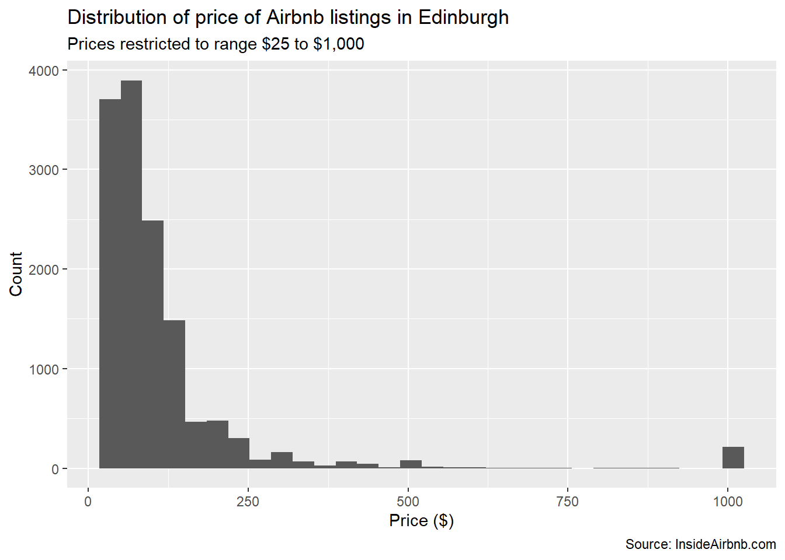

1.  Look at the plot and compare it to the code: see whether you can map each line of code to each each element of the plot?

2.  Also, why we did we use a *histogram* and not a bar chart?

3.  The ggplot2 package works by adding layers. Try the following:

``` r
# Layer 1 

listings %>%
  ggplot(aes(price)) 
```

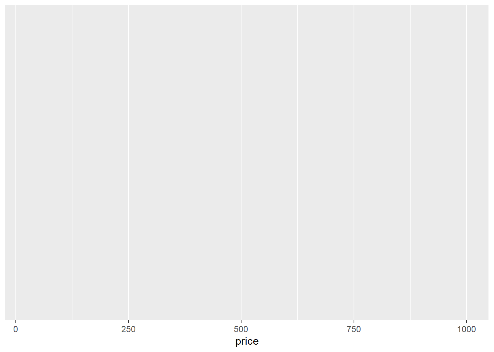

Remember we can also write this as one line (or layer):

``` r
ggplot(listings, aes(price))
```

But we will stick to the tidyverse method of pipes and building pipelines. It will make things easier to read and understand.

**Note:** for this code chunk immediately above, I used code code only (we haven’t seen that yet). I suppressed the plot output by `fig.show = 'hide'` in the curly brackets. Look at the [RMarkdown Cookbook](https://bookdown.org/yihui/rmarkdown-cookbook/) for more on this: here is the link to [Section 11.7 Hide code, text output, messages or plots](https://bookdown.org/yihui/rmarkdown-cookbook/hide-one.html).

**Layer 1:** **Dataset and variable(s)**

We first pipe our dataset (`listings`) to `ggplot`. The function [`aes()`](https://ggplot2.tidyverse.org/reference/aes.html) is our aesthetics: What variable(s) is it we want to plot? `ggplot` creates a background layer, which shows the values of the `price` variable. Run the code and have a look at this now.

**Layer 2:** **Plot Type**

Next, we need to tell ggplot how we want the values of this variable mapped. This is the geom. In Excel, it would called the Chart Type. There are various geoms (or geometric objects) like: [`geom_histogram()`](https://ggplot2.tidyverse.org/reference/geom_histogram.html), [`geom_density()`](https://ggplot2.tidyverse.org/reference/geom_density.html), [`geom_bar()`](https://ggplot2.tidyverse.org/reference/geom_bar.html), [`geom_boxplot()`](https://ggplot2.tidyverse.org/reference/geom_boxplot.html) etc. In other words, the types of plots.

To do this, we need to add another layer. We’ll do this using the `+` sign.

``` r
# Layer 1 + Layer 2

listings %>%
  ggplot(aes(price)) + # adding another layer using the '+' symbol
  geom_histogram() # Layer 2 will add the type of plot we want
```

``` text
## `stat_bin()` using `bins = 30`. Pick better value with `binwidth`.
```

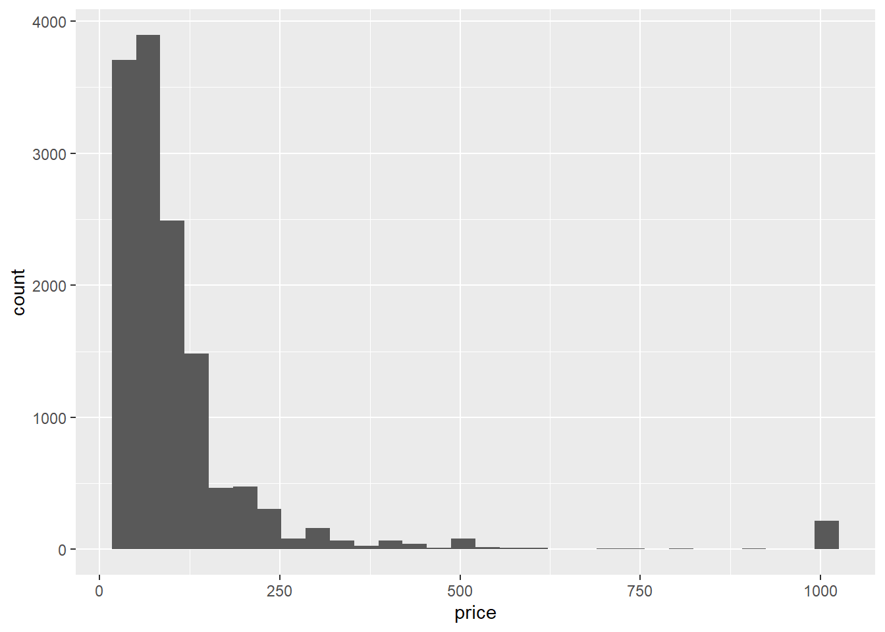

Have a look at the result. Is there anything missing?

**Layer 3:** **Labels**

We still have to tidy our plot up by labelling it correctly. We’ll do that by adding another layer. We can add labels via the labs() function: we’re going to add a **main title, a subtitle, label our x and y axes,** and then **add a caption** underneath which shows the where the data came from.

``` r
# Layer 1 + Layer 2 + Layer 3

listings %>%
  ggplot(aes(price)) + # adding the values we want to plot
  geom_histogram() + # adding the type of plot we want
  labs(title = "Distribution of price of Airbnb listings in Edinburgh",
       subtitle = "Prices restricted to range $25 to $1,000",
       x = "Price ($)",
       y = "Count",
       caption = "Source: InsideAirbnb.com")
```

``` text
## `stat_bin()` using `bins = 30`. Pick better value with `binwidth`.
```


This might seem a bit more effort than in Excel. However, by adding layer upon layer, you end up with total control over every element of your plots and can create unique visualisations that are hard or impossible to create in other software packages (like Excel).

**Practice:** create a histogram of the bathrooms variable:

``` r
listings %>%
  ggplot(aes(bathrooms)) + # adding the values we want to plot
  geom_histogram() + # adding the type of plot we want
  labs(title = "Distribution of bathrooms of Airbnb listings in Edinburgh",
       x = "Number of bathrooms",
       y = "Count",
       caption = "Source: InsideAirbnb.com")
```

``` text
## `stat_bin()` using `bins = 30`. Pick better value with `binwidth`.
```

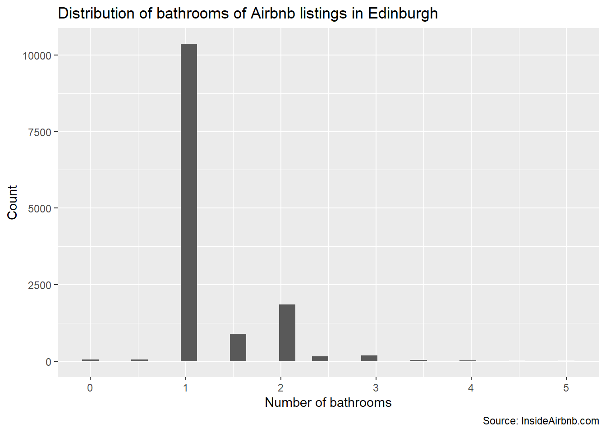 <span id="density-plot-of-the-price-showing-how-the-price-varies-by-room_type."></span>

#### 4.0.2.2 **2. Density plot of the price showing how the price varies by room_type.**

Note: Ensure that the scales make sense and that you label it properly.

We’ll add three layers again:

1\. **Our data/variable(s) layer:** our dataset and variable(s). Note we are using two variables now as we are plotting price by the type of room (‘entire home/appt’, ‘private room’, ‘shared room’). We can thus see the distribution of price for an entire home, for example, and compare that with the distribution of price for just one private room, say.

2\. **Our plot layer:** our `geom()` function or the actual plot we want to create. We’ll use a density plot: this can be use if distributions overlap.

3\. **Our labels layer:** the [`labs()`](https://ggplot2.tidyverse.org/reference/labs.html) function or the types of labels we want to add to our plot.

See if you can isolate the layers below. As in the tutorial, try to run them layer by layer to see how we build the plot:

``` r
listings %>%
  ggplot(aes(price, fill = room_type)) +
  geom_density(alpha = 0.5) +
  labs(title = "Distribution of price of Airbnb listings in Edinburgh",
       subtitle = "Prices restricted to range $25 to $1,000",
       x = "Price ($)",
       y = "Count",
       caption = "Source: InsideAirbnb.com",
       fill = "Room type")
```

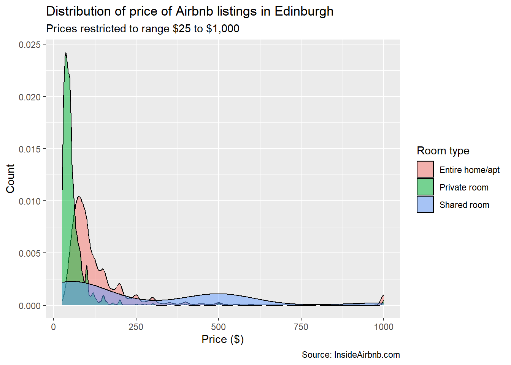

You should read the Course Reading (if you have not already): **Fogarty, Chapter 8: Visualising Data.**

In particular, see the section on **Histograms**. He describes both Histograms and Density Plots, and therefore is required Reading for this Tutorial.

OK, we’ve added in a few more pieces of information this time. See if you can answer the questions below, therefore:

1.  What does the `fill = room_type` do in the aesthetics or [`aes()`](https://ggplot2.tidyverse.org/reference/aes.html) function?

2.  What does `fill = "Room type"` do in the labels or [`labs()`](https://ggplot2.tidyverse.org/reference/labs.html) function?

3.  What does `alpha = 0.5` do in the [`geom_density()`](https://ggplot2.tidyverse.org/reference/geom_density.html) function? Try to change its values and then re-Knit the document to see what it does.

**Answers:**

1.  What does the `fill = room_type` do in the aesthetics or [`aes()`](https://ggplot2.tidyverse.org/reference/aes.html) function?

*It’s going to create the density plot by filling the distribution with colour.*

2.  What does `fill = "Room type"` do in the labels or [`labs()`](https://ggplot2.tidyverse.org/reference/labs.html) function?

*It’s going to change the default label “room_type” to whatever we want to call it. So we can change the raw variable name (room_type) to something others can better understand (“Room Type”).*

*The use of this might be more obvious if we had a raw variable name that made no sense e.g. in the tutorial we looked at the Codebook and the variable qb. We could therefore change this to something that was more accessible and made more sense.*

3.  What does `alpha = 0.5` do in the `geom-density()` function? Try to change its values and then re-Knit the document to see what it does.

*It controls the opacity or transparency of the colour. We need to see the other distributions below when one overlaps the other.*

Save your observations to the questions by writing them into your RMarkdown document for future reference. **Start doing this from now on: using the document to store and save your observations and learning.** It will then become a method of learning *and* source of answers, code and tips further down the line (e.g. when doing the Assignments).

<span id="histogram-or-density-plot-of-review_scores_rating."></span>

#### 4.0.2.3 **3. Histogram or density plot of review_scores_rating.**

We’ll return to the histogram now. This time we’ll create a histogram of the variable `review_scores_rating`. We will be able to see what the distribution of reviews looks like therefore: are they all really good or bad or is there a mix?

See if you can see the three layers below. And again, run the code layer by layer to see how it builds up.

``` r
# A histogram of review_scores_rating 

listings %>%
  drop_na(review_scores_rating) %>%
  ggplot(aes(review_scores_rating)) +
  geom_histogram() +
  expand_limits(x = 0) + # otherwise won't start at zero
  labs(title = "Distribution of average review score of Airbnb listings in Edinburgh",
       x = "Review score (out of 100)",
       y = "Count",
       caption = "Source: InsideAirbnb.com")
```

``` text
## `stat_bin()` using `bins = 30`. Pick better value with `binwidth`.
```

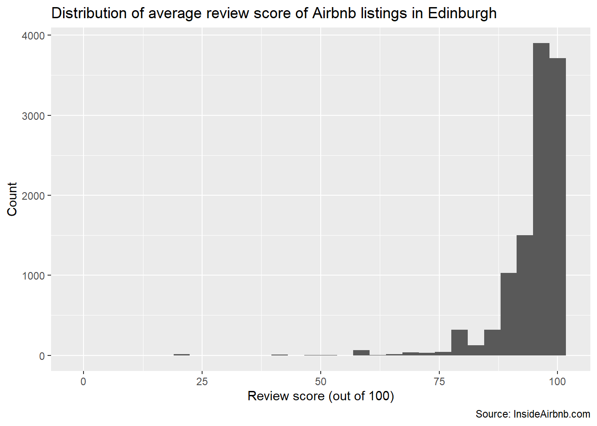

Note that we didn’t need a subtitle this time. We’re not looking at price, so don’t need to explain that we restricted its values.

We can see that the distribution is highly skewed: most of the properties get a rating of 75 (out of 100) or higher. You might want to look up *skew* at this point, even if intuitively you know what it means from looking at the histogram.

**Now try to create a density plot:** showing how the ratings variable varies by the type or category of room (‘entire home/appt’, ‘private room’, ‘shared room’).

Look back to Exercise 2 above if you get stuck…

**Now a Question:**

1.  We’re using two variables: `review_scores_rating` and `room_type`. What are their data types (numeric, factor, character)?

Answer: Their data types are: numeric (`review_scores_rating`) and factor (`room_type`).

Try to get into the habit of understanding what the data types are. This will help you understand what plots are available. For **numeric** data types, common plots are: *histogram, density plot* and *boxplot*.

We can’t use a boxplot (for example) for a **factor** variable. Factor variables will have their own types of plots e.g. bar plots. Again, see the Fogarty Chapter 8 (Bar Plots section).

If you tried, ggplot will make an attempt but it will not make much sense or it will return an error. Let’s quickly plot `room_type`.

1.  What kind of data type is it?
2.  What kind of plot would be appropriate therefore?

``` r
# boxplot of room_type
listings %>% 
  ggplot(aes(room_type)) +
  geom_boxplot()
```

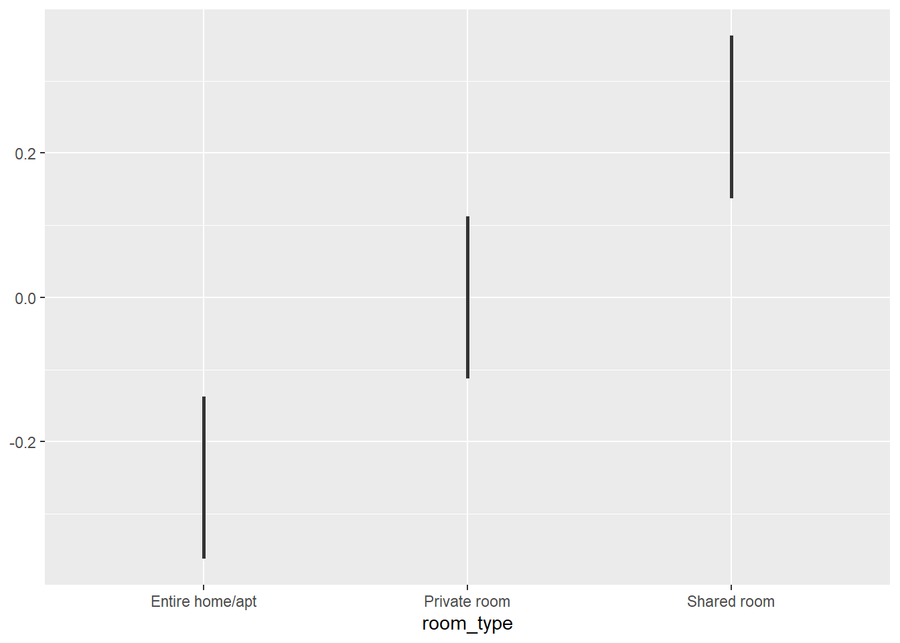

``` r
# bar plot of room_type
listings %>% 
  ggplot(aes(room_type)) +
  geom_bar()
```

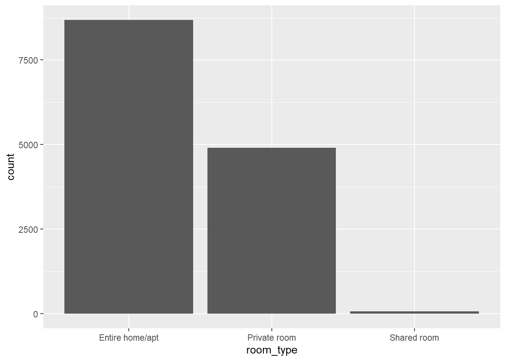

Hopefully, you will have seen the second one makes sense. This is because:

1.  What kind of data type is it?

    *It’s a factor variable.*

2.  What kind of plot would be appropriate therefore?

    *A bar plot.*

The ggplot cheatsheet from [Datacamp](https://www.datacamp.com/cheat-sheet/ggplot2-cheat-sheet) or this original from [RStudio](https://ggplot2.tidyverse.org/) will be a good reference over time.

OK. I will put you out your misery. What was the answer - or at least *an* answer - to creating the density plot. Here it is:

``` r
# Density plot of reviews by room types:

listings %>%
  ggplot(aes(review_scores_rating, fill = room_type)) +
  geom_density(alpha = 0.5) +
  labs(title = "Distribution of review ratings of Airbnb listings in Edinburgh",
       x = "Review score (out of 100)",
       y = "Count",
       caption = "Source: InsideAirbnb.com",
       fill = "Room type")
```

``` text
## Warning: Removed 2511 rows containing non-finite outside the scale range (`stat_density()`).
```

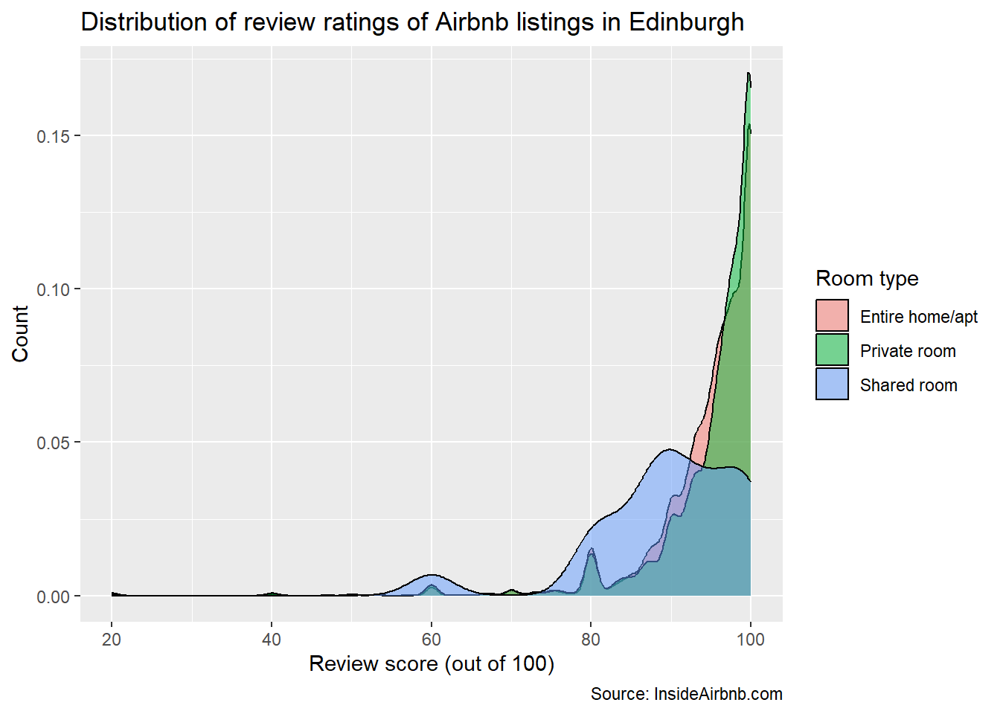

**Question:** Why do we get a warning message? What could we do about it?

**Hint:** use the [`drop_na()`](https://tidyr.tidyverse.org/reference/drop_na.html) function. What would go in the brackets? Where would you put or insert the line of code?

  

OK. *Substantively*, when we get to the highest ratings (90\>), there are more Private rooms and Entire homes/apt. It looks like they are fairly similar in terms of review scores, which is perhaps surprising? I would have thought Entire homes/appt might have been higher.

Shared rooms seem to get more of the lower-upper distribution (scores around 75-90) and then starts to tail off, where the other two types increase.

*Technically*, we are using a numeric variable (`review_scores_rating`) and a factor variable (`room_type`) . What does this do? In effect, we get *three* numeric plots (density plots) for the price of one: three distributions all on the same plot. Why three?

Because there are three *factor levels* to `room_type`. So we get a density plot for each. This very useful to compare and explore our data.

**Extra Practice:**

1.  Try changing the code above: change the `geom` from density plot to boxplot. How many boxplots do you think we will get?
2.  Change the code above: this time change the variable from `room_type` to `property_type`. How many levels does the factor variable property_type have? What will the effect be on our plot?

**Answers:**

1.  Try changing the code above: change the `geom` from density plot to boxplot. **Note:** we no longer need the `fill` argument. How many boxplots do you think we will get?

``` r
# Boxplot of reviews by room types:

listings %>%
  drop_na(review_scores_rating) %>% 
  ggplot(aes(x = review_scores_rating, y = room_type)) +
  geom_boxplot() +
  labs(title = "Distribution of review ratings of Airbnb listings in Edinburgh",
       x = "Review score (out of 100)",
       y = "Type of Room",
       caption = "Source: InsideAirbnb.com",
       fill = "Room type")
```

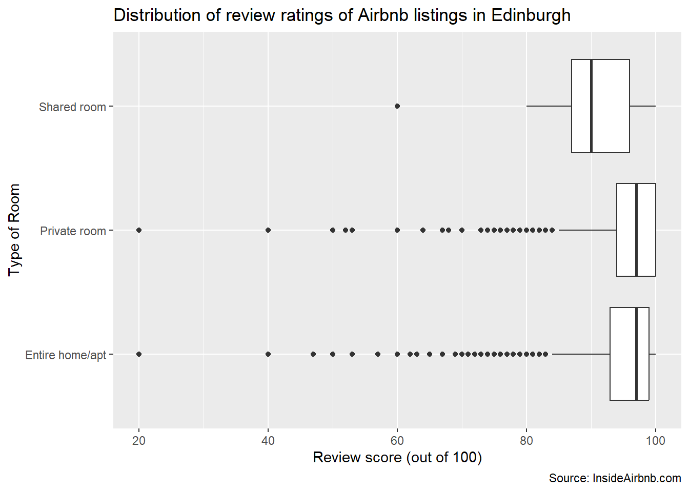

We get three boxplots, because our factor variable (room_type) has three levels. To interpret the boxplots, again read the Fogarty chapter.

2.  Change the code above: this time change the variable from `room_type` to `property_type`. How many levels does the factor variable property_type have? What will the effect be on our plot?

``` r
# Density plot of reviews by property types:

listings %>%
  drop_na(review_scores_rating) %>% 
  ggplot(aes(review_scores_rating, fill = property_type)) +
  geom_density(alpha = 0.5) +
  labs(title = "Distribution of review ratings of Airbnb listings in Edinburgh",
       x = "Review score (out of 100)",
       y = "Count",
       caption = "Source: InsideAirbnb.com",
       fill = "Property type")
```

``` text
## Warning: Groups with fewer than two data points have been dropped.
## Groups with fewer than two data points have been dropped.
## Groups with fewer than two data points have been dropped.
## Groups with fewer than two data points have been dropped.
## Groups with fewer than two data points have been dropped.
```

``` text
## Warning in max(ids, na.rm = TRUE): no non-missing arguments to max; returning -Inf
## Warning in max(ids, na.rm = TRUE): no non-missing arguments to max; returning -Inf
## Warning in max(ids, na.rm = TRUE): no non-missing arguments to max; returning -Inf
## Warning in max(ids, na.rm = TRUE): no non-missing arguments to max; returning -Inf
## Warning in max(ids, na.rm = TRUE): no non-missing arguments to max; returning -Inf
```

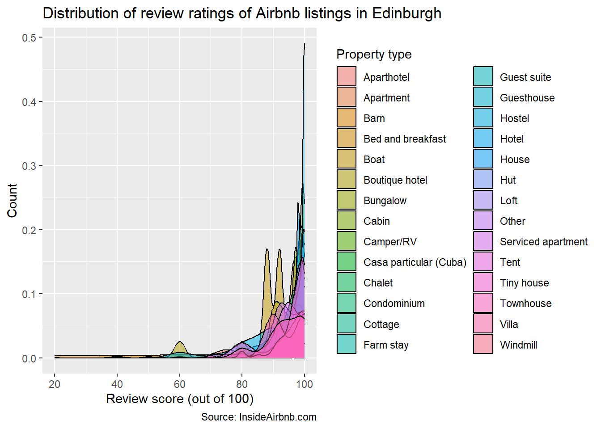

There are 30 levels in property_type: from Apartment to Windmill

``` r
# have a quick check of how many levels we have:
levels(listings$property_type)
```

``` text
##  [1] "Aparthotel"             "Apartment"              "Barn"                  
##  [4] "Bed and breakfast"      "Boat"                   "Boutique hotel"        
##  [7] "Bungalow"               "Cabin"                  "Camper/RV"             
## [10] "Campsite"               "Casa particular (Cuba)" "Chalet"                
## [13] "Condominium"            "Cottage"                "Earth house"           
## [16] "Farm stay"              "Guest suite"            "Guesthouse"            
## [19] "Hostel"                 "Hotel"                  "House"                 
## [22] "Hut"                    "Loft"                   "Other"                 
## [25] "Serviced apartment"     "Tent"                   "Tiny house"            
## [28] "Townhouse"              "Villa"                  "Windmill"
```

This is *way* too much for a plot. As a result, it’s a bit of a mess and thus hard to interpret. We gets lots of warnings too: basically, saying some of our factor levels have as little as 2 observations. That’s so small we’re going to drop them and not even bother plotting them says `ggplot`. Some levels like `Boat` and `Earth House` have been dropped therefore.

What we *can* see however is that property_type is all over the place, so to speak: Lots of *very* different types of properties (from Camper Van to Boutique Hotel). From that point of view, the plot *is* useful: data visualisation, like descriptive statistics (Tutorial 2) is part of exploratory data analysis so we are getting to know our data and out variables much better. `property_type` thus contains a lot of variation within it. Perhaps, in time, we might think about re-categorizing the levels, ourselves: say, reducing them down from 30 types to maybe 4-5? We can return to this at a later date but, for now, making plots helps give us this information and thus helps us make decisions about whether we might need to further transform our data.

Data Visualisation is very important in exploring and understanding your data so make sure you do some extra work on your own here:

1.  **Fogarty Chapter 8**: Visualising Data
2.  **R for Data Science**: [Data Visualisation](https://r4ds.had.co.nz/data-visualisation.html)
3.  And use **the recommended courses** from [Datacamp](https://www.datacamp.com/groups/shared_links/a87cb6d0aa31c4840ae3cf934073fd484f6e4e0639c18e101bc8822bed186053)

Finally, make sure you experiment: change the variables and see what happens. Play about with the data. Make sure you apply what you have learned therefore: don’t just work through the exercises and think you have understood everything necessarily. Again, Datacamp is good here as it assigns you exercises to do.

We’ve done a lot in Tutorial 3 therefore:

1.  **Transitioned to RMarkdown:** we created a new RMarkdown document, recreated all the previous changes and worked through Lab Tutorial 3 using it. It made it much easier for you to make notes and observations as you go and start to teach yourself and use it as a learning document. Make sure you do more work on learning RMarkdown: R for Data Science is excellent as always: see the [RMarkdown chapter](https://r4ds.had.co.nz/r-markdown.html).
2.  **Learned about `ggplot`:** we worked through the process of creating layers and generating our first plots. We also used a few new arguments like `fill` and `alpha`.
3.  **Learned about data visualisation:** we learned about the necessity of knowing our data types so we know which plots are appropriate; we learned about the function of data visualisation too in the process of exploratory data analysis and how, like descriptive statistics, data visualisation helps us to get to know our data.

[3 Tutorial 2: Descriptive Statistics](https://qdaworkbook.netlify.app/tutorial-2-descriptive-statistics) [5 Tutorial 4: Data Visualisation - Numeric and Factor variables](https://qdaworkbook.netlify.app/tutorial-4-data-visualisation---numeric-and-factor-variables)
