> Source: [Chapter 5 Tutorial 4_ Data Visualisation - Numeric and Factor variables _ QDA Lab Workbook.html](../Tutorial/Tutorial_4/Chapter%205%20Tutorial%204_%20Data%20Visualisation%20-%20Numeric%20and%20Factor%20variables%20_%20QDA%20Lab%20Workbook.html) · [Original workbook page](https://qdaworkbook.netlify.app/tutorial-4-data-visualisation-%2D-numeric-and-factor-variables)

<span id="tutorial-4-data-visualisation---numeric-and-factor-variables"></span>

# 5 Tutorial 4: Data Visualisation - Numeric and Factor variables

We’ll get set up as before. You have two options here now.

1.  Use the *same* RMarkdown document as last week. We’re still on the Data Visualisation topic so this makes sense. Don’t let these get these too big that you can acesss and retrieve what you need. And certainly, if we move to a new topic (e.g. Inference as next week), create a new document.

2.  Or you can set up a new RMarkdown document. This is absolutely fine, especially if you feel your other has become unwieldy and has too much in it (everyone will be different). As before, we will create a new RMarkdown document. This means we start with a blank slate and will need to create or recreate whatever we need within the RMarkdown document.

If you chose Option 2, create a new RMarkdown document and delete out all the unnecessary text..

Our set up code chunk deliberately has the argument `include=FALSE` since we neither want the code nor the output to show in the knitted document. It will just run ‘quietly’ in the background. Here is the code our initial setup chunk:

``` r
# load in our libraries
library(tidyverse)

# Read in our data
listings <- read_csv("listings_edinburgh.csv") 
```

``` text
## Rows: 14014 Columns: 10
## ── Column specification ──────────────────────────────────────────────────────────────────────────
## Delimiter: ","
## chr (4): name, neighbourhood_cleansed, property_type, room_type
## dbl (6): accommodates, bathrooms, bedrooms, beds, price, review_scores_rating
## 
## ℹ Use `spec()` to retrieve the full column specification for this data.
## ℹ Specify the column types or set `show_col_types = FALSE` to quiet this message.
```

``` r
# recreate the changes from Lab Tutorials 1-2:

# Tutorial 1: coerce room_type from character to factor
listings <- mutate(listings,
                   room_type = factor(room_type),
                   property_type = factor(property_type))


# Tutorial 2: filter out any extreme or questionable values
listings <- filter(listings,
                   price >= 25, price <= 1000, bathrooms <= 5) %>%
  drop_na(price, bedrooms, bathrooms) # and drop any missing (na) values
```

As before, we can add a temporary chunk and check everything is OK:

``` r
glimpse(listings) # check our variable data types
```

``` text
## Rows: 13,647
## Columns: 10
## $ name                   <chr> "Georgian Boutique Apt City Centre", "Cool central Loft, sleeps 4…
## $ neighbourhood_cleansed <chr> "Old Town, Princes Street and Leith Street", "Meadows and Southsi…
## $ property_type          <fct> Apartment, Loft, Apartment, Condominium, Condominium, Apartment, …
## $ room_type              <fct> Entire home/apt, Entire home/apt, Entire home/apt, Private room, …
## $ accommodates           <dbl> 2, 4, 2, 2, 2, 3, 5, 5, 6, 10, 2, 4, 3, 2, 2, 4, 2, 4, 10, 5, 2, …
## $ bathrooms              <dbl> 1.0, 1.5, 1.0, 1.0, 1.0, 1.0, 1.0, 1.5, 1.0, 2.0, 1.0, 2.0, 1.0, …
## $ bedrooms               <dbl> 1, 2, 0, 1, 1, 1, 2, 3, 4, 4, 1, 1, 1, 1, 1, 2, 1, 1, 5, 1, 1, 1,…
## $ beds                   <dbl> 1, 2, 2, 1, 1, 2, 3, 2, 5, 7, 1, 1, 1, 1, 1, 2, 1, 1, 5, 2, 1, 1,…
## $ price                  <dbl> 80, 115, 46, 32, 100, 71, 175, 150, 139, 190, 85, 64, 79, 60, 55,…
## $ review_scores_rating   <dbl> 99, 92, 94, 93, 98, 97, 100, 92, 96, 99, 77, 98, 98, 96, 98, 89, …
```

Everything looks correct. I’ll delete this off the document now as it’s no longer required.

Now we’ve set everything up, we can proceed with the exercises.

<span id="tutorial-4-exercises"></span>

## 5.1 Tutorial 4 Exercises

<span id="boxplot-showing-how-price-varies-between-room_type."></span>

#### 5.1.0.1 1. Boxplot showing how price varies between room_type.

``` r
listings %>%
  ggplot(aes(room_type, price)) +
  geom_boxplot() +
  labs(title = "Distribution of price of Airbnb listings in Edinburgh",
       subtitle = "Prices restricted to range $25 to $1,000",
       x = "Room type",
       y = "Price ($)",
       caption = "Source: InsideAirbnb.com")
```


We have a lot of outliers in `Entire home/appt` and `Private Room`. So many that they are affecting our ability to see the actual boxplots of these two variables. Ideally, we want to ‘zoom’ in. To do so, we could use a logarithmic scale. Instead of the outliers stretching out and distorting our plot as it were, the logarithm *compresses* the y-axis values: the values are no longer stretched out.

We’ll add another layer, using the function [`scale_y_log10()`](https://ggplot2.tidyverse.org/reference/scale_continuous.html)

``` r
listings %>%
  ggplot(aes(room_type, price)) +
  geom_boxplot() +
  scale_y_log10()  +
  labs(title = "Distribution of price of Airbnb listings in Edinburgh",
       subtitle = "Prices restricted to range $25 to $1,000",
       x = "Room type",
       y = "Price ($)",
       caption = "Source: InsideAirbnb.com")
```

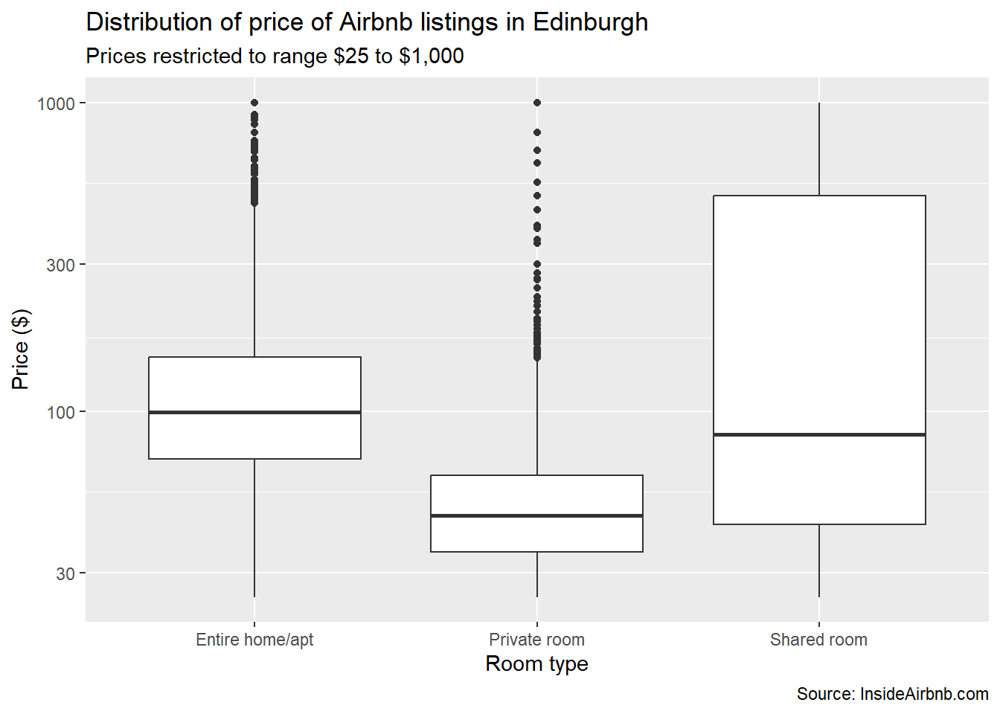

Notice that range of values on the y-axis has now been compressed. Look at the y-axis: the distance between \$300 and \$1,000 has been much reduced so we can ‘zoom’ into the actual boxplots themselves rather than the outliers.

**Question:** Look at the boxplots now.

1.  What is the line in the middle of the box?

2.  What do the boxes themselves represent?

3.  What five statistics does the plot give us?

See **Chapter 8 (Visualising Data)** from the **Fogarty book**: *Box Plots* section

  

<span id="plot-showing-the-distribution-of-bedrooms-among-listings."></span>

#### 5.1.0.2 2. Plot showing the distribution of bedrooms among listings.

We can try a histogram first.

``` r
listings %>%
  ggplot(aes(bedrooms)) +
  geom_histogram() +
  labs(title = "Distribution of bedrooms",
       x = "Bedrooms",
       y = "Count")
```

``` text
## `stat_bin()` using `bins = 30`. Pick better value with `binwidth`.
```

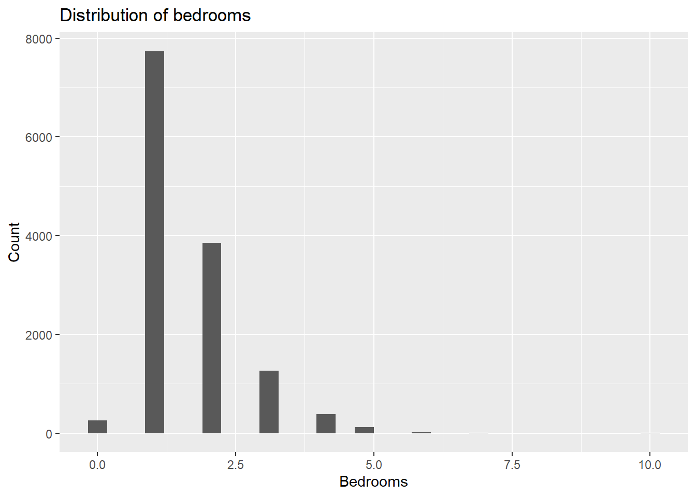

We could also think of using a bar plot. Bedrooms is a variable with relatively few unique values.

Let’s try it now by changing the `geom()` to `geom_bar`:

``` r
listings %>%
  ggplot(aes(bedrooms)) +
  geom_bar() +
  labs(title = "Distribution of bedrooms",
       x = "Bedrooms",
       y = "Count")
```

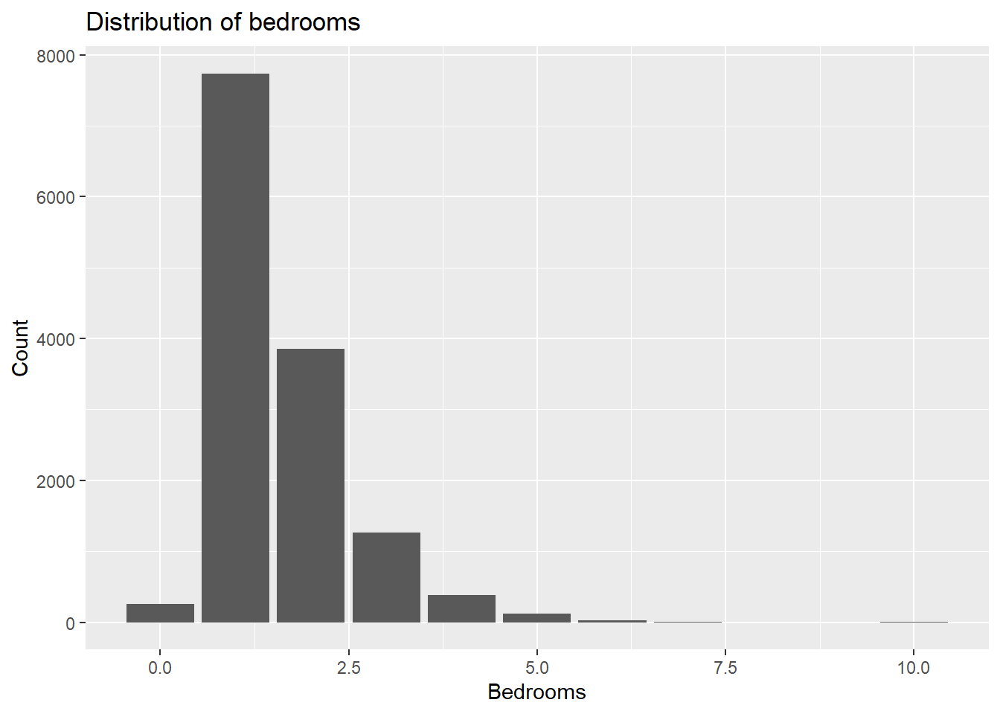

We could further refine this. The x axis is currently a continuous scale, making it hard to read.

We could use the [`mutate()`](https://dplyr.tidyverse.org/reference/mutate.html) function to coerce bedrooms to factor. And then pipe that to ggplot. That will mean the x axis scale will be easier to read.

``` r
listings %>%
  mutate(bedrooms = factor(bedrooms)) %>%
  ggplot(aes(bedrooms)) +
  geom_bar() +
  labs(title = "Distribution of bedrooms",
       x = "Bedrooms",
       y = "Count")
```

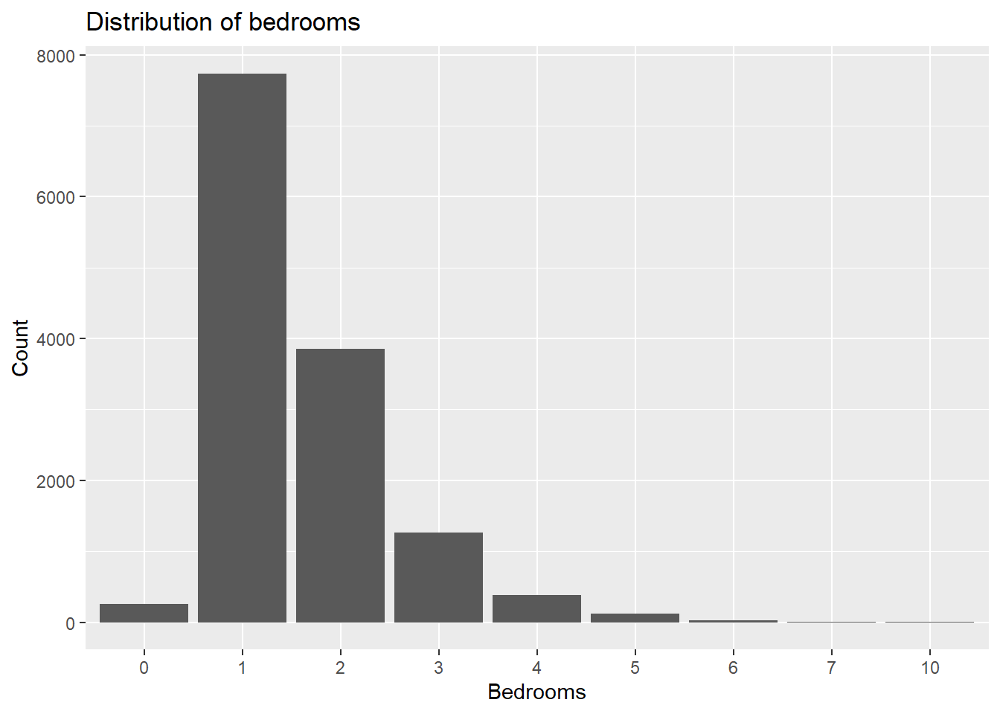

We also know from our previous summary statistics work in Tutorial 2 that Bedrooms has `NA` values.

Also, there is no number 8 and 9 shown on the chart (because there are no properties with 8 or 9 bedrooms). Run the first few lines of code to see how many bedrooms are in each:

``` r
listings %>%
  mutate(bedrooms = factor(bedrooms)) %>% 
  count(bedrooms)
```

``` text
## # A tibble: 9 × 2
##   bedrooms     n
##   <fct>    <int>
## 1 0          257
## 2 1         7737
## 3 2         3853
## 4 3         1265
## 5 4          386
## 6 5          118
## 7 6           24
## 8 7            6
## 9 10           1
```

One way we could deal with this is to:

1.  change the number of levels (categories) of our variable using the [`factor()`](https://rdrr.io/r/base/factor.html) function: beginning at 0 (bedrooms) and up to 10
2.  use the [`count()`](https://dplyr.tidyverse.org/reference/count.html) function to count how many bedrooms are in each level (or category)
3.  use the [`complete()`](https://tidyr.tidyverse.org/reference/complete.html) function to turn implicit missing values into explicit categories i.e. put an actual zero in categories 8 and 9 bedrooms. That way they will be actually be plotted as 8 and 9, instead of jumping from 7… to 10.

Finally, let’s drop any `NA` values.

``` r
listings %>%
  drop_na(bedrooms) %>% 
  mutate(bedrooms = factor(bedrooms, levels = 0:10)) %>%
  count(bedrooms) %>%
  complete(bedrooms, fill = list(n = 0)) %>%
  ggplot(aes(bedrooms, n)) +
  geom_col() +
  labs(title = "Distribution of bedrooms",
       x = "Bedrooms",
       y = "Count")
```

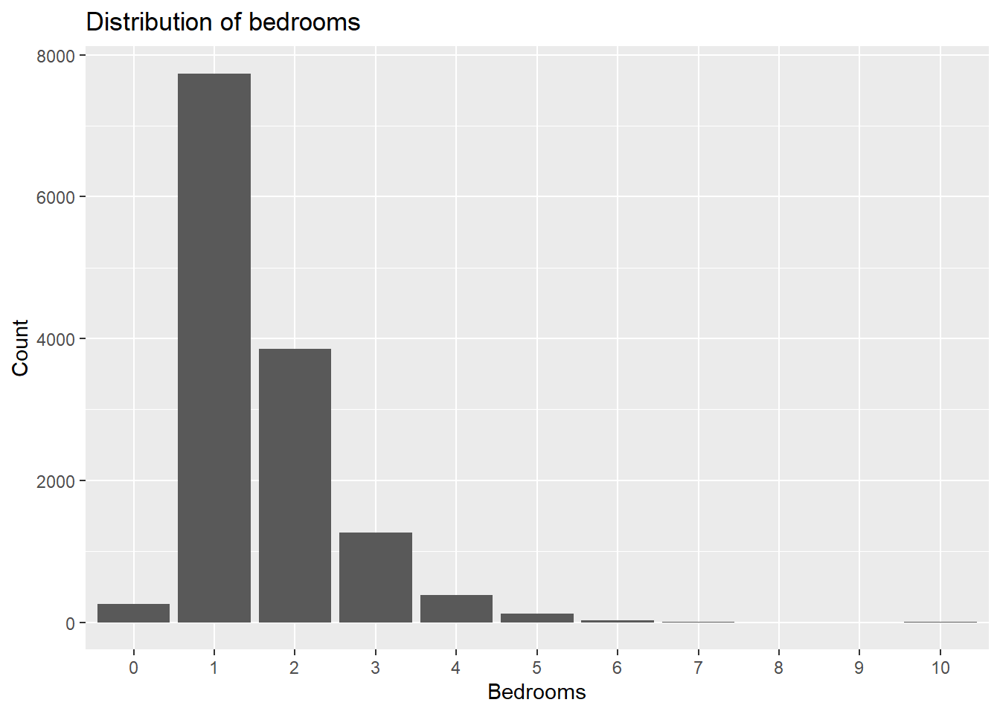

Depending on what you are doing you might not have wanted to go this far. Notice, though, that our first attempt at a plot is often just that: a first pass. We then start to modify and change things - sometimes experimenting - in order to reach the final version. So don’t worry if your first plot looks far from ideal. This is often the way you would go about producing good-looking plots.

<span id="price-and-review_score_rating."></span>

#### 5.1.0.3 3. Price and review_score_rating.

Firstly, we’ll drop the `NA` values in the `review_scores_rating` variable. Then pipe that to ggplot.

What would be an appropriate plot? We have two numeric variables and want to show their relationship: Let’s try a scatterplot.

``` r
listings %>%
  drop_na(review_scores_rating) %>%
  ggplot(aes(review_scores_rating, price)) +
  geom_point() +
  labs(title = "Price versus average review score",
       x = "Average review score",
       y = "Price ($)",
       caption = "Source: InsideAirbnb.com")
```

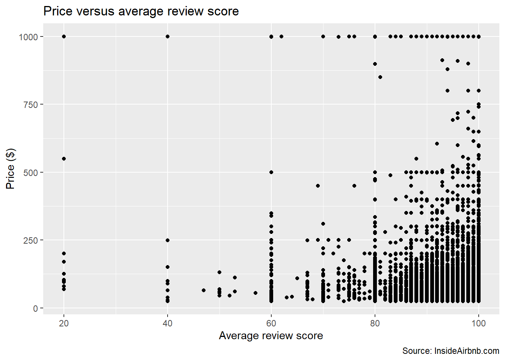

This is pretty good. Let’s refine it a little. At the moment, all the points with the same values are stacked on top of each other. We want to be able to see these points a bit better.

Firstly, we’ll control the transparency of the points by setting the alpha value again. We can then better see the points directly underneath.

Try specifying a value for *alpha* in the [`geom_point()`](https://ggplot2.tidyverse.org/reference/geom_point.html) function:

``` r
listings %>%
  drop_na(review_scores_rating) %>%
  ggplot(aes(review_scores_rating, price)) +
  geom_point(alpha = 0.1) +
  labs(title = "Price versus average review score",
       x = "Average review score",
       y = "Price ($)",
       caption = "Source: InsideAirbnb.com")
```

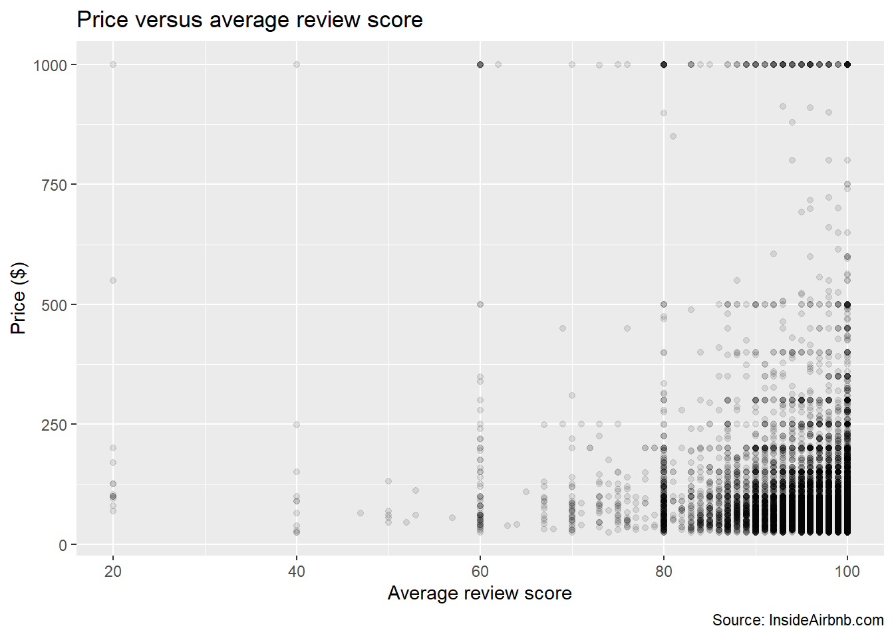

**Optional:** Experiment with the alpha settings:

1.  What does `alpha = 1` look like?

2.  What does `alpha = 0.5` look like?

3.  What does `alpha = 0` look like?

4.  Which is full transparency and which is its opposite?

It’s better but some of the points still lie directly on top of each other. We can ‘jitter’ them, which means move them very slightly so they don’t directly overlap.

For this we can use `geom_jitter`, which is the same as `geom_point`, except for the ‘jitter’. Let’s keep our alpha the same.

Note we can stipulate the x and y variables. See the code below. And by doing so, we can control which variable goes on the x axis: I’m choosing `review_scores_rating` because normally we put the variable we want to explain on the y axis (`price`) and the variable that does the ‘explaining’ on the x axis (`review_scores_rating)`.

``` r
listings %>%
  drop_na(review_scores_rating) %>%
  ggplot(aes(x = review_scores_rating, y= price)) +
  geom_jitter(alpha = 0.1) +
  labs(title = "Price versus average review score",
       x = "Average review score",
       y = "Price ($)",
       caption = "Source: InsideAirbnb.com")
```

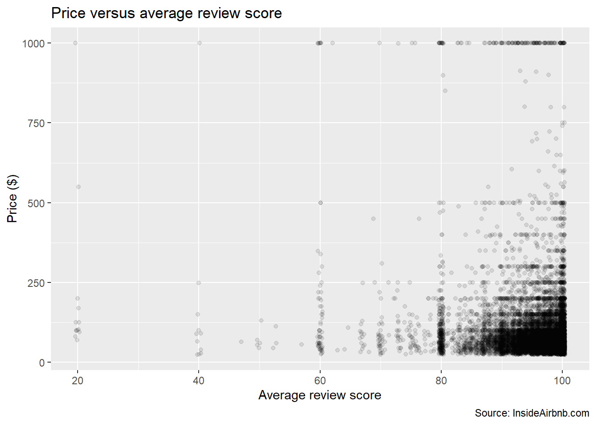

Try comparing the plots: was this any better? If not, then feel free to keep the version you best prefer.

**Question**: After all that, *is* there a relationship between price and review_scores_rating? If so, how would you describe it?

One thing we could so is to add a line: does it go upward (positive relationship) or downwards (negative). We can use the function `geom_smooth`:

``` r
listings %>%
  drop_na(review_scores_rating) %>%
  ggplot(aes(x = review_scores_rating, y= price)) +
  geom_jitter(alpha = 0.1) +
  geom_smooth(se = FALSE) +
  labs(title = "Price versus average review score",
       x = "Average review score",
       y = "Price ($)",
       caption = "Source: InsideAirbnb.com")
```

``` text
## `geom_smooth()` using method = 'gam' and formula = 'y ~ s(x, bs = "cs")'
```

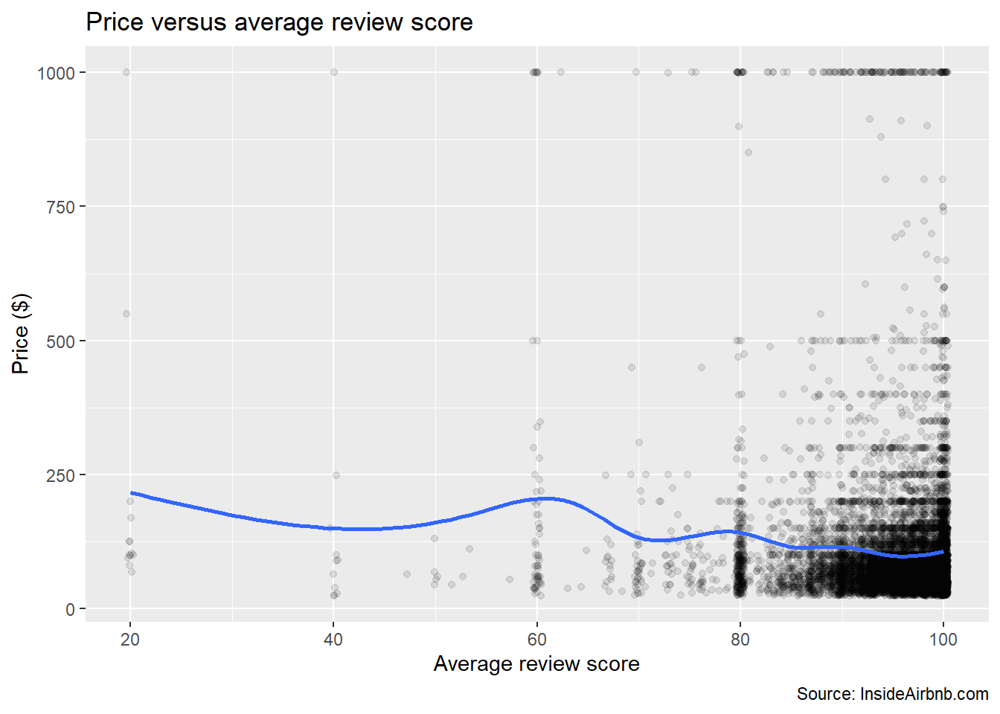

It’s unclear. If anything it seems to go down the way overall, which is odd.

To help you learn more, read the Fogarty chapter: and see the section on **Scatterplots.** Fogarty also has a useful section here adding a third variable in scatterplots. Following his suggestion, we can add a factor variable to ‘colour’ our points. I will use `room_type` to see whether the relationship between `price` and `review_scores_rating` changes between room types: maybe the relationship between price and reviews (high price, high reviews for example) is different for a full apartment or house? Let’s have a look:

``` r
listings %>%
  drop_na(review_scores_rating) %>%
  ggplot(aes(x = review_scores_rating, y= price, colour = room_type)) +
  geom_jitter(alpha = 0.1) +
  labs(title = "Price versus average review score",
       x = "Average review score",
       y = "Price ($)",
       caption = "Source: InsideAirbnb.com")
```

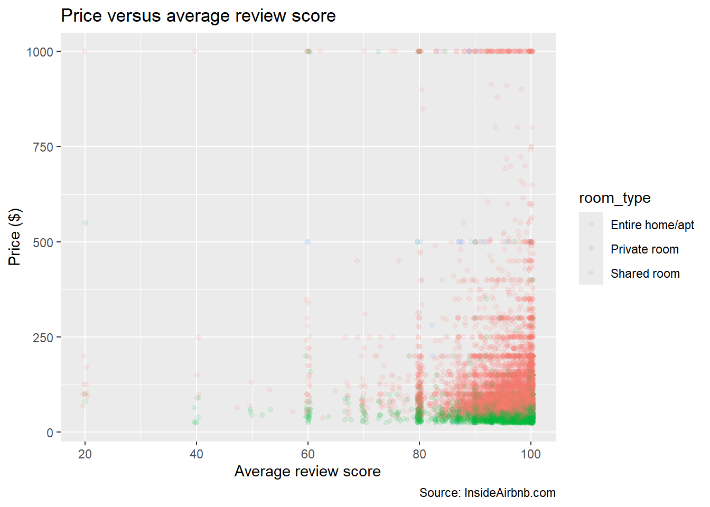

I can’t see anything definitive to be honest. Both `Private Rooms` and `Entire homes/apartments` seem to get high reviews: 80 and over on the x axis of review scores. For these, `Entire homes/apartments` seem to be more expensive: they are more spread out along the y axis of price. Does that mean there is a relationship between `price` and `review_scores_rating`? It’s unclear, I think. Private Rooms are cheaper but still get high reviews. There are more `Entire homes/apartments` perhaps because there are simply *more* of them: 8,677.

``` r
listings %>% 
  count(room_type)
```

``` text
## # A tibble: 3 × 2
##   room_type           n
##   <fct>           <int>
## 1 Entire home/apt  8677
## 2 Private room     4901
## 3 Shared room        69
```

Finally, let’s add back in our smoothing lines:

``` r
listings %>%
  drop_na(review_scores_rating) %>%
  ggplot(aes(x = review_scores_rating, y= price, colour = room_type)) +
  geom_jitter(alpha = 0.1) +
  geom_smooth() +
  labs(title = "Price versus average review score",
       x = "Average review score",
       y = "Price ($)",
       caption = "Source: InsideAirbnb.com")
```

``` text
## `geom_smooth()` using method = 'gam' and formula = 'y ~ s(x, bs = "cs")'
```

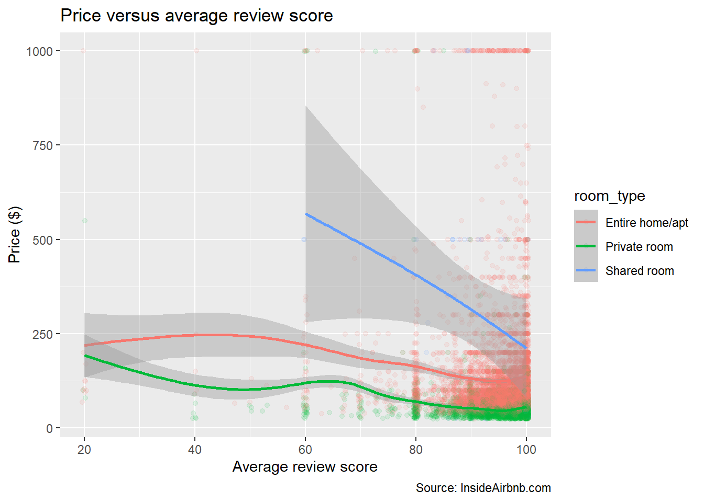

Again, weirdly, if anything it seems to go down the way (a negative relationship) - and for all room types, particularly `Shared Room`. We’ll return to this in Tutorial 6.

<span id="the-distribution-of-property_type."></span>

#### 5.1.0.4 4. The distribution of property_type.

The `property_type` variable is a factor variable so at this point we move on from plotting numeric to factor variables. We spoke previously about appropriate plots. For a factor variable, one of the most common is a bar plot. Let’s try this now.

``` r
listings %>%
  ggplot(aes(x = property_type)) +
  geom_bar() +
    labs(title = "Distribution of property type",
       x = "Property types",
       y = "Count",
       caption = "Source: InsideAirbnb.com")
```

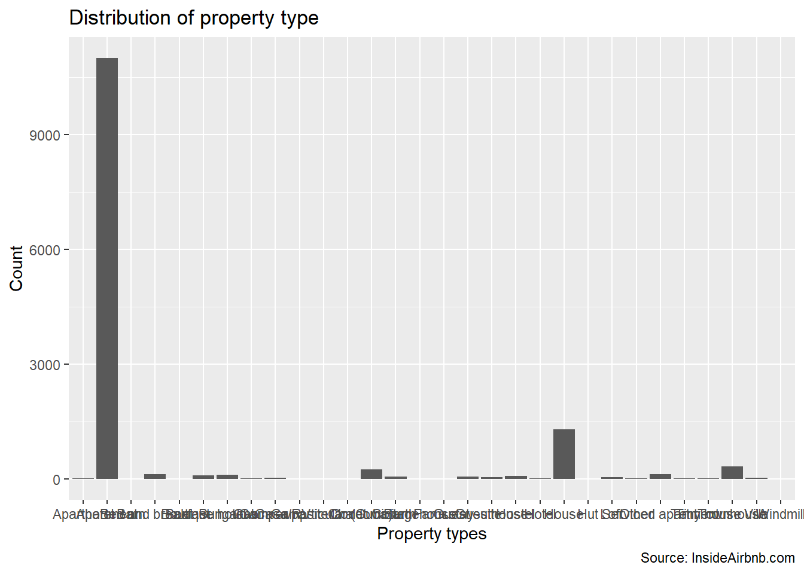

This is quite good but there are two problems:

**Problem 1.** We cannot read the x axis: this is a common problem with bar charts when they have a lot of categories or levels. Let’s check how many we actually have.

``` r
levels(listings$property_type)
```

``` text
##  [1] "Aparthotel"             "Apartment"              "Barn"                  
##  [4] "Bed and breakfast"      "Boat"                   "Boutique hotel"        
##  [7] "Bungalow"               "Cabin"                  "Camper/RV"             
## [10] "Campsite"               "Casa particular (Cuba)" "Chalet"                
## [13] "Condominium"            "Cottage"                "Earth house"           
## [16] "Farm stay"              "Guest suite"            "Guesthouse"            
## [19] "Hostel"                 "Hotel"                  "House"                 
## [22] "Hut"                    "Loft"                   "Other"                 
## [25] "Serviced apartment"     "Tent"                   "Tiny house"            
## [28] "Townhouse"              "Villa"                  "Windmill"
```

So we have 30 levels, hence the issue. An easy way to fix this is to ‘flip’ the chart with the coord_flip() function:

``` r
# ordered: low to high
listings %>%
  ggplot(aes(x = property_type)) +
  geom_bar() +
  coord_flip() +
    labs(title = "Distribution of property type",
       x = "Property types",
       y = "Count",
       caption = "Source: InsideAirbnb.com")
```

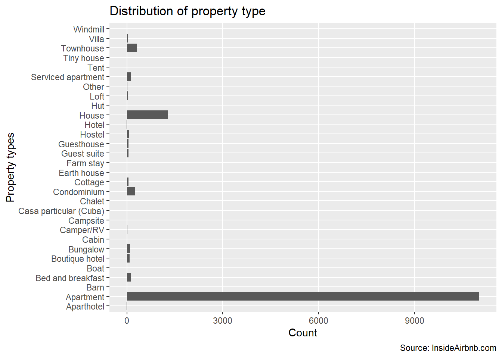

**Problem 2.** Next we need to order them. We’ll use `fct_infreq`:

``` r
# ordered: low to high
listings %>%
  ggplot(aes(x = fct_infreq(property_type))) +
  geom_bar() +
  coord_flip() +
    labs(title = "Distribution of property type",
       x = "Property types",
       y = "Count",
       caption = "Source: InsideAirbnb.com")
```

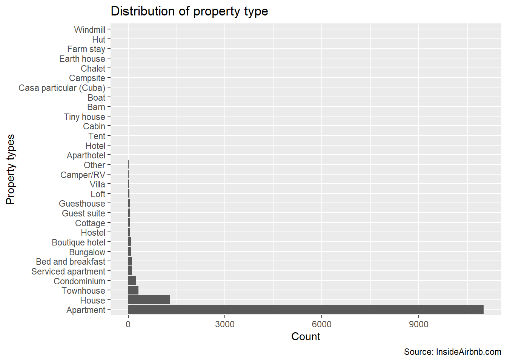

That’s better but the bars go in decreasing order; I’d prefer them in increasing order.

To reverse the order, we will use the advice above from [R for Data Science](https://r4ds.had.co.nz/factors.html)and combine [`fct_infreq()`](https://forcats.tidyverse.org/reference/fct_inorder.html) with [`fct_rev()`](https://forcats.tidyverse.org/reference/fct_rev.html):

``` r
# ordered: low to high
listings %>%
  ggplot(aes(x = fct_rev(fct_infreq(property_type)))) +
  geom_bar() +
  coord_flip() +
  labs(title = "Distribution of property type",
       x = "Property types",
       y = "Count",
       caption = "Source: InsideAirbnb.com")
```

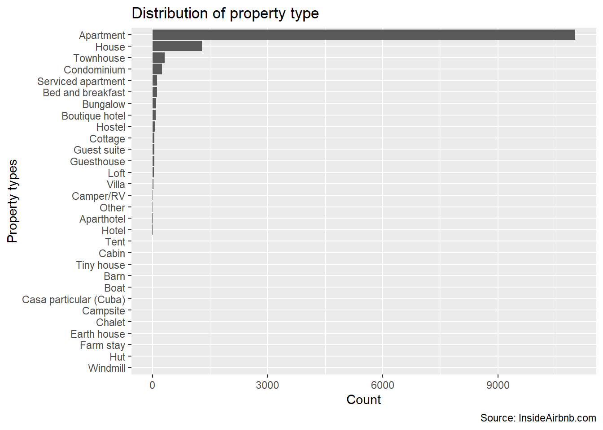

That looks better. We have our final plot at last.

N.B. There is a package in the Tidyverse called **forcats**. One of its uses it for reordering the levels of a factor variable, which is useful in plotting. Look at [Chapter 15 of R for Data Science](https://r4ds.had.co.nz/factors.html) for a good introduction. Remember I’ve suggested this book previously (and is also part of the recommended course reading). Note that Chapter 15 suggests the following:

> *“…you can use [`fct_infreq()`](https://forcats.tidyverse.org/reference/fct_inorder.html) to order levels in increasing frequency: this is the simplest type of reordering because it doesn’t need any extra variables. You may want to combine with [`fct_rev()`](https://forcats.tidyverse.org/reference/fct_rev.html).”*

  

<span id="table-showing-the-top-10-neighbourhoods-based-on-the-number-of-listings."></span>

#### 5.1.0.5 5. Table showing the top 10 neighbourhoods (based on the number of listings).

We’re going to use the [`count()`](https://dplyr.tidyverse.org/reference/count.html) function again, as we did in Tutorial 2.

Try running only the first two lines of code and see what they do.

``` r
listings %>%
  count(neighbourhood_cleansed)
```

``` text
## # A tibble: 111 × 2
##    neighbourhood_cleansed                      n
##    <chr>                                   <int>
##  1 Abbeyhill                                 220
##  2 Baberton and Juniper Green                 21
##  3 Balerno and Bonnington Village             21
##  4 Balgreen and Roseburn                      85
##  5 Barnton, Cammo and Cramond South           11
##  6 Bingham, Magdalene and The Christians      22
##  7 Blackford, West Mains and Mayfield Road   143
##  8 Blackhall                                  48
##  9 Bonaly and The Pentlands                   29
## 10 Bonnington                                113
## # ℹ 101 more rows
```

Note down your observations. Remember that the [`count()`](https://dplyr.tidyverse.org/reference/count.html) function will create a new variable called `n`. What are we going to do with that `n`? Try to figure it out…

Now run the first three lines of code: what happens?

``` r
listings %>%
  count(neighbourhood_cleansed) %>%
  arrange(-n)
```

``` text
## # A tibble: 111 × 2
##    neighbourhood_cleansed                        n
##    <chr>                                     <int>
##  1 Old Town, Princes Street and Leith Street   976
##  2 Tollcross                                   644
##  3 Deans Village                               598
##  4 Meadows and Southside                       557
##  5 Dalry and Fountainbridge                    495
##  6 Hillside and Calton Hill                    492
##  7 Canongate, Southside and Dumbiedykes        411
##  8 Stockbridge                                 394
##  9 New Town West                               331
## 10 New Town East and Gayfield                  325
## # ℹ 101 more rows
```

What does the `-n` do?

Try changing `arrange(-n)` to `arrange(n)` and see what happens. Again, note down your observations.

Finally, run all four lines of code. What happens?

``` r
listings %>%
  count(neighbourhood_cleansed) %>%
  arrange(-n) %>% 
  head(10)
```

``` text
## # A tibble: 10 × 2
##    neighbourhood_cleansed                        n
##    <chr>                                     <int>
##  1 Old Town, Princes Street and Leith Street   976
##  2 Tollcross                                   644
##  3 Deans Village                               598
##  4 Meadows and Southside                       557
##  5 Dalry and Fountainbridge                    495
##  6 Hillside and Calton Hill                    492
##  7 Canongate, Southside and Dumbiedykes        411
##  8 Stockbridge                                 394
##  9 New Town West                               331
## 10 New Town East and Gayfield                  325
```

What does the function [`head()`](https://rdrr.io/r/utils/head.html) do? Again, you really need to experiment to learn: change the head function from 10 to 30, for example.

Change [`head()`](https://rdrr.io/r/utils/head.html) to [`tail()`](https://rdrr.io/r/utils/head.html): see what happens.

``` r
listings %>%
  count(neighbourhood_cleansed) %>%
  arrange(n) %>% 
  tail(10)
```

``` text
## # A tibble: 10 × 2
##    neighbourhood_cleansed                        n
##    <chr>                                     <int>
##  1 New Town East and Gayfield                  325
##  2 New Town West                               331
##  3 Stockbridge                                 394
##  4 Canongate, Southside and Dumbiedykes        411
##  5 Hillside and Calton Hill                    492
##  6 Dalry and Fountainbridge                    495
##  7 Meadows and Southside                       557
##  8 Deans Village                               598
##  9 Tollcross                                   644
## 10 Old Town, Princes Street and Leith Street   976
```

Try to experiment and play around with the code as this is one of the best ways to learn it.

**Optional Exercise:** change `head(10)` to `tail(10)`, and now try changing `arrange(-n)` to `arrange(n)`: do you get the same results? Do they look exactly the same?

  

<span id="plot-showing-the-top-10-neighbourhoods-based-on-the-number-of-listings."></span>

#### 5.1.0.6 6. Plot showing the top 10 neighbourhoods (based on the number of listings).

Instead of a table, we’re going to *plot* the top 10 neighborhoods.

1.  What kind of plot would be appropriate?
2.  What `geom()` would we need for this type of plot?

Use [`glimpse()`](https://pillar.r-lib.org/reference/glimpse.html) on the `listings()` data:

``` r
glimpse(listings)
```

``` text
## Rows: 13,647
## Columns: 10
## $ name                   <chr> "Georgian Boutique Apt City Centre", "Cool central Loft, sleeps 4…
## $ neighbourhood_cleansed <chr> "Old Town, Princes Street and Leith Street", "Meadows and Southsi…
## $ property_type          <fct> Apartment, Loft, Apartment, Condominium, Condominium, Apartment, …
## $ room_type              <fct> Entire home/apt, Entire home/apt, Entire home/apt, Private room, …
## $ accommodates           <dbl> 2, 4, 2, 2, 2, 3, 5, 5, 6, 10, 2, 4, 3, 2, 2, 4, 2, 4, 10, 5, 2, …
## $ bathrooms              <dbl> 1.0, 1.5, 1.0, 1.0, 1.0, 1.0, 1.0, 1.5, 1.0, 2.0, 1.0, 2.0, 1.0, …
## $ bedrooms               <dbl> 1, 2, 0, 1, 1, 1, 2, 3, 4, 4, 1, 1, 1, 1, 1, 2, 1, 1, 5, 1, 1, 1,…
## $ beds                   <dbl> 1, 2, 2, 1, 1, 2, 3, 2, 5, 7, 1, 1, 1, 1, 1, 2, 1, 1, 5, 2, 1, 1,…
## $ price                  <dbl> 80, 115, 46, 32, 100, 71, 175, 150, 139, 190, 85, 64, 79, 60, 55,…
## $ review_scores_rating   <dbl> 99, 92, 94, 93, 98, 97, 100, 92, 96, 99, 77, 98, 98, 96, 98, 89, …
```

What data type is the `neighbourhood_cleansed` variable currently? What should we do?

1.  We can change it from a character to a factor variable (as we did in Tutorial 1). This means then we can count the number of occurrences as well as use a bar plot.

2.  then using [`fct_infreq()`](https://forcats.tidyverse.org/reference/fct_inorder.html) and [`fct_rev()`](https://forcats.tidyverse.org/reference/fct_rev.html) in combination as we did previously, we can sort the data for our bar plot.

3.  Then use `arrange(-n)` to give us high to low

4.  Then use the [`head()`](https://rdrr.io/r/utils/head.html) function to give us the first 10 observations: so a kind of Top 10 neighbourhoods plot.

``` r
listings %>%
  mutate(neighbourhood_cleansed = factor(neighbourhood_cleansed) %>% 
           fct_infreq() %>% 
           fct_rev()) %>%
  count(neighbourhood_cleansed) %>%
  arrange(-n) %>% 
  head(10) 
```

``` text
## # A tibble: 10 × 2
##    neighbourhood_cleansed                        n
##    <fct>                                     <int>
##  1 Old Town, Princes Street and Leith Street   976
##  2 Tollcross                                   644
##  3 Deans Village                               598
##  4 Meadows and Southside                       557
##  5 Dalry and Fountainbridge                    495
##  6 Hillside and Calton Hill                    492
##  7 Canongate, Southside and Dumbiedykes        411
##  8 Stockbridge                                 394
##  9 New Town West                               331
## 10 New Town East and Gayfield                  325
```

We’ll then pipe this to ggplot:

``` r
listings %>%
  mutate(neighbourhood_cleansed = factor(neighbourhood_cleansed) %>% 
           fct_infreq() %>% 
           fct_rev()) %>%
  count(neighbourhood_cleansed) %>%
  arrange(-n) %>% 
  head(10) %>% # now pipe to ggplot
  ggplot(aes(neighbourhood_cleansed, n)) +
  geom_col() +
  coord_flip() +
  labs(title = "Airbnb listings by neighbourhood",
       subtitle = "Top 10 neighbourhoods", 
       x = "",
       y = "",
       caption = "Source: InsideAirbnb.com")
```

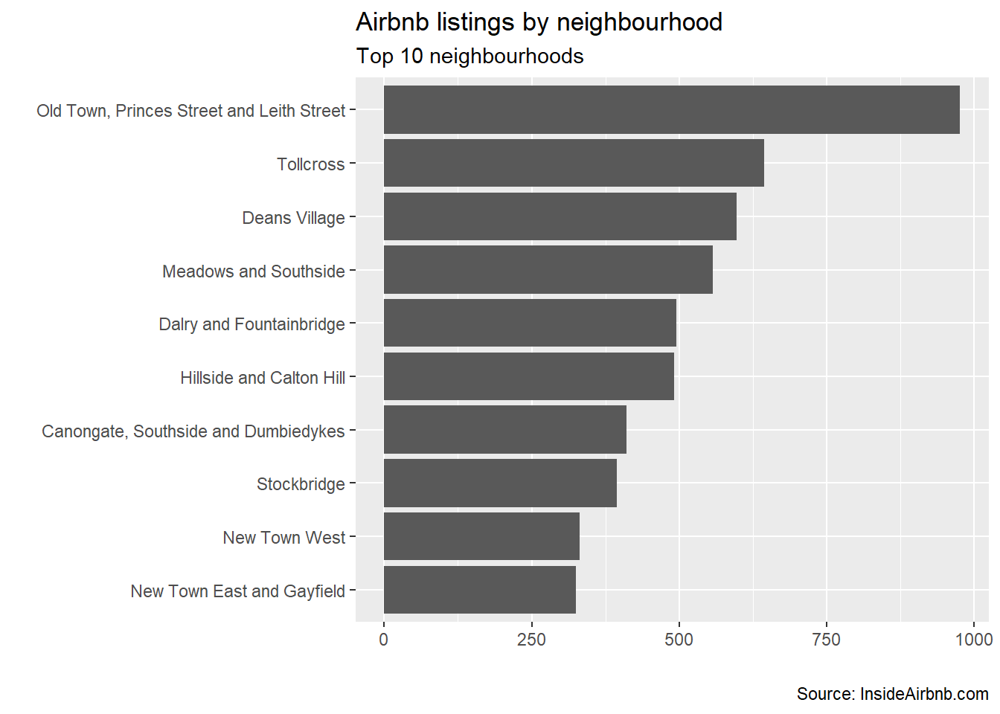

Try to get extra practice with ggplot. [R for Data Science: Chapter 3 (Data Visualisation)](https://r4ds.had.co.nz/data-visualisation.html) is very good on bar plots and plots generally; [Chapter 15 (Factors)](https://r4ds.had.co.nz/factors.html) is very good on factors and bar plots.

And, if you want to go further, see [Chapter 28 (Graphics for communication)](https://r4ds.had.co.nz/graphics-for-communication.html). There is also Datacamp as well, remember.

<span id="extra-tips"></span>

## 5.2 Extra Tips

<span id="ggplot-themes"></span>

#### 5.2.0.1 1. `ggplot` themes

One of the things we can do to improve our plots in ggplot is to use its inbuilt themes. If we take our example from Question 1, using a boxplot:

``` r
listings %>%
  ggplot(aes(room_type, price)) +
  geom_boxplot() +
  labs(title = "Distribution of price of Airbnb listings in Edinburgh",
       subtitle = "Prices restricted to range $25 to $1,000",
       x = "Room type",
       y = "Price ($)",
       caption = "Source: InsideAirbnb.com")
```

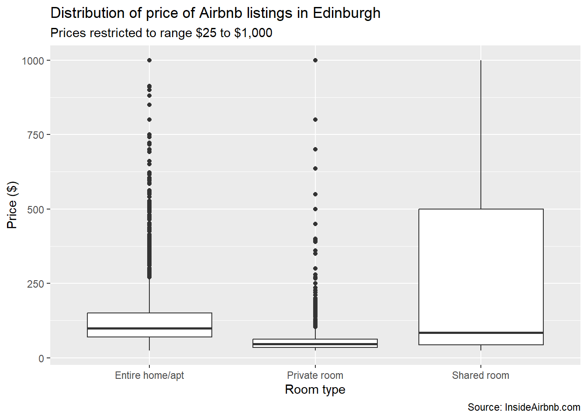

We can add in another layer: I’ll use `theme_minimal`:

``` r
listings %>%
  ggplot(aes(room_type, price)) +
  geom_boxplot() +
  theme_minimal() +
  labs(title = "Distribution of price of Airbnb listings in Edinburgh",
       subtitle = "Prices restricted to range $25 to $1,000",
       x = "Room type",
       y = "Price ($)",
       caption = "Source: InsideAirbnb.com")
```

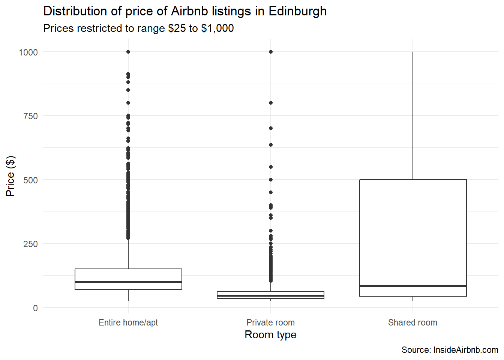

This gives us an out-the-box theme, which is of high quality. If you want to see what other themes are available, type in `theme_` and then **tab** to use autocomplete and see the suggestions which come up. You will also find some of them, with examples, on the [ggplot cheatsheet](https://www.rstudio.org/links/data_visualization_cheat_sheet)

**A further example:** We spoke about Violin plots, which gives us the shape of the distribution like a density plot. We can combine both boxplot and violin plot as follows:

``` r
listings %>%
  ggplot(aes(room_type, price)) +
  geom_boxplot(width = 0.5) +
  geom_violin(alpha = 0.2) +
  scale_y_log10()  +
  labs(title = "Distribution of price of Airbnb listings in Edinburgh",
       subtitle = "Prices restricted to range $25 to $1,000",
       x = "Room type",
       y = "Price ($)",
       caption = "Source: InsideAirbnb.com")
```

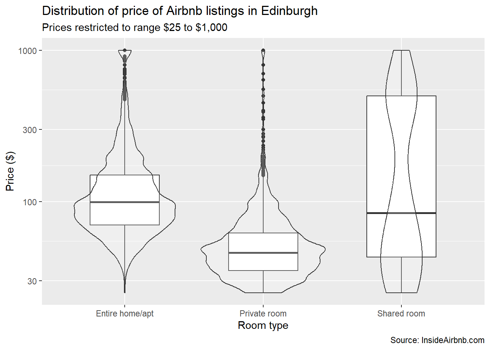

It looks a little odd because of the default `ggplot` theme. We can change this however and improve it by adding another `ggplot` theme. Again, I’ll use `theme_minimal`. I will add this just before the `labels` layer.

**N.B.** You may have to experiment with the `width` and `alpha` arguments for `geom_boxplot` and `geom_violin`:

``` r
listings %>%
  ggplot(aes(room_type, price)) +
  geom_boxplot(width = 0.1) +
  geom_violin(alpha = 0.2) +
  scale_y_log10()  +
  theme_minimal() +
  labs(title = "Distribution of price of Airbnb listings in Edinburgh",
       subtitle = "Prices restricted to range $25 to $1,000",
       x = "Room type",
       y = "Price ($)",
       caption = "Source: InsideAirbnb.com")
```

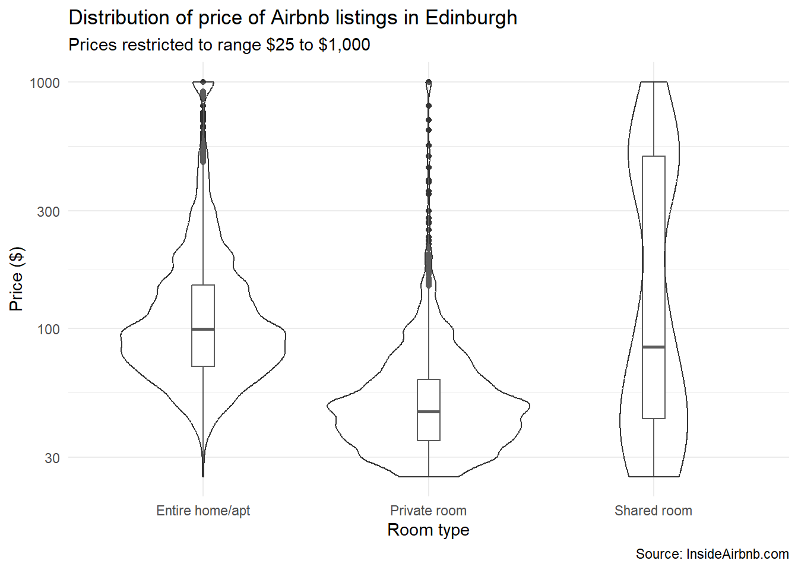

We get the best of both worlds: boxplot and violin. As Fogarty says in Chapter 8:

> *Another and increasingly popular option is violin plots that combine box plots with density plots.*

Remember to make sure you can interpret both boxplots and violin plots through reading this chapter. And note, if you are going to use both plots, you need to interpret both otherwise there is no point combining them. So you could use the violin plot to explore the overall distribution (like a histogram) but the boxplot to break that distribution down (into median, quartiles, interquartile range, outliers etc.)

Finally, to compare them side by side (or any charts), one approach is to use the package called `gridExtra`. Note you will need to install this if you have not got this. You can easily check in **Window Pane 4**: click on the **Packages tab** to see and search what packages you have installed.

Remember you install a new package **in the console**. Do *not* do this in your RMarkdown document or you are likely to get errors or the document not knitting.

Once you have installed it, you will need to load the `gridExtra` package.

``` r
#load library
library(gridExtra)
```

``` text
## Warning: package 'gridExtra' was built under R version 4.4.1
```

``` text
## 
## Attaching package: 'gridExtra'
```

``` text
## The following object is masked from 'package:dplyr':
## 
##     combine
```

``` r
# Step 1: Create your first plot

plot1 <- listings %>%
  ggplot(aes(room_type, price)) +
  geom_boxplot() +
  scale_y_log10()  +
  labs(title = "Distribution of price of Airbnb listings in Edinburgh",
       subtitle = "Prices restricted to range $25 to $1,000",
       x = "Room type",
       y = "Price ($)",
       caption = "Source: InsideAirbnb.com")


# Step 2: Create your first plot

plot2 <- listings %>%
  ggplot(aes(room_type, price)) +
  geom_violin() +
  scale_y_log10()  +
  labs(title = "Distribution of price of Airbnb listings in Edinburgh",
       subtitle = "Prices restricted to range $25 to $1,000",
       x = "Room type",
       y = "Price ($)",
       caption = "Source: InsideAirbnb.com")

# Step 3: Now compare them side by side using the grid.arrange function from the gridExtra package:
grid.arrange(plot1, plot2, ncol = 2)
```

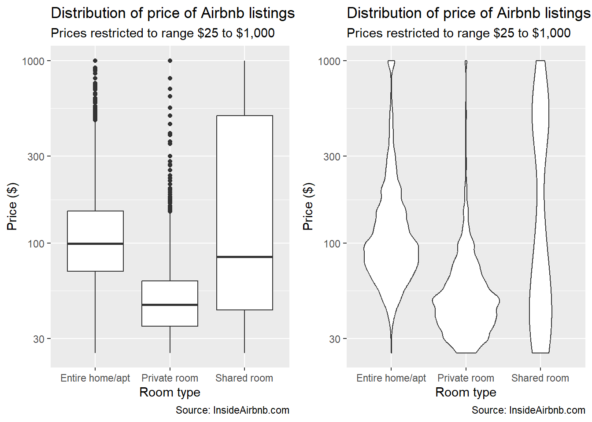

We can now compare them side by side.

Strictly, speaking it was bad practice for me to load the library in that chunk. I just did it to keep things simple. What I should have done is load it in *the very first chunk* of my RMarkdown document: the *setup chunk*. That is where we load all our libraries and I should have loaded it underneath the tidyverse. Make sure you doithis in future. The reason is twofold:

1.  You will lose track of what libraries you have loaded or now if they are scattered throughout your RMarkdown document.
2.  Some code operations require the library to be available from the beginning of the document. You will then get an error: this happens a lot if you forget to load the tidyverse. So by loading all libraries at the outset, you will not have this problem.

  

<span id="bar-plots"></span>

#### 5.2.0.2 2. Bar plots

If you look at [Chapter 3.8 of R for Data Science](https://r4ds.had.co.nz/data-visualisation.html#position-adjustments), the authors give some very useful information on bar charts. In particular, they highlight the use of the `position` argument. This is not obvious so it is worth covering here.

<span id="default-bar-chart"></span>

##### 5.2.0.2.1 2.1. Default bar chart

When we create a bar chart, the default `position` is: `position = identity`. You do not need to state this as it is assumed as the default. We’ll test this out by comparing two plots: one without starting `position = identity`; and the other which *does* directly state it:

``` r
# Default
plot1 <- listings %>% 
ggplot(aes(room_type)) +
  geom_bar() + 
  labs(x = "Room Type", y = "Count")

# Add the position argument in geom_bar() function
plot2 <- listings %>% 
ggplot(aes(room_type)) +
  geom_bar(position = "identity") + # note the quotes
  labs(x = "Room Type", y = "Count")

# compare them
grid.arrange(plot1, plot2, ncol = 2)
```

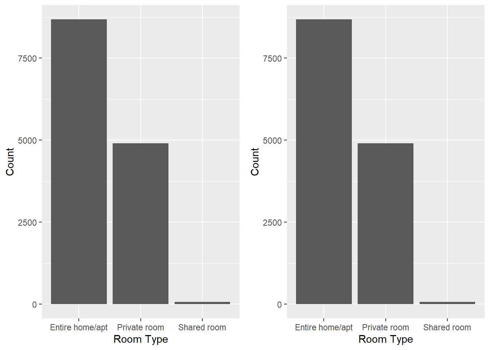

Because `position = identity` is the default, they are exactly the same whether we include this or not. This is similar to `echo=TRUE` in our RMarkdown work.

Note this default uses counts (see y axis).

<span id="proportional-stacked-bar-chart"></span>

##### 5.2.0.2.2 2.2. Proportional Stacked Bar Chart

However, by changing the `position` argument we can create different kinds of bar charts. If we change `position` to `position=fill`, we get a **proportional stacked bar chart**.

To do so:

1.  We need to tell `ggplot` in the aesthetics layer what variable we want to use to *fill* the bar chart, or its columns rather.

<!-- -->

2.  We then need to add the `position = fill` argument into the `geom` layer.

So using the example above, say I want to find out the relationship between `room_type` and `property_type`: two *factor* variables. I want to see whether, say, a full apartment/home is more likely to be a hotel or a home rather than a tent or camper van. An example should help clarify:

``` r
listings %>% 
ggplot(aes(x = room_type, fill = property_type)) + # Point 1
  geom_bar(position = "fill") + # Point 2: note the quotes
  labs(x = "Room Type", y = "Count")
```

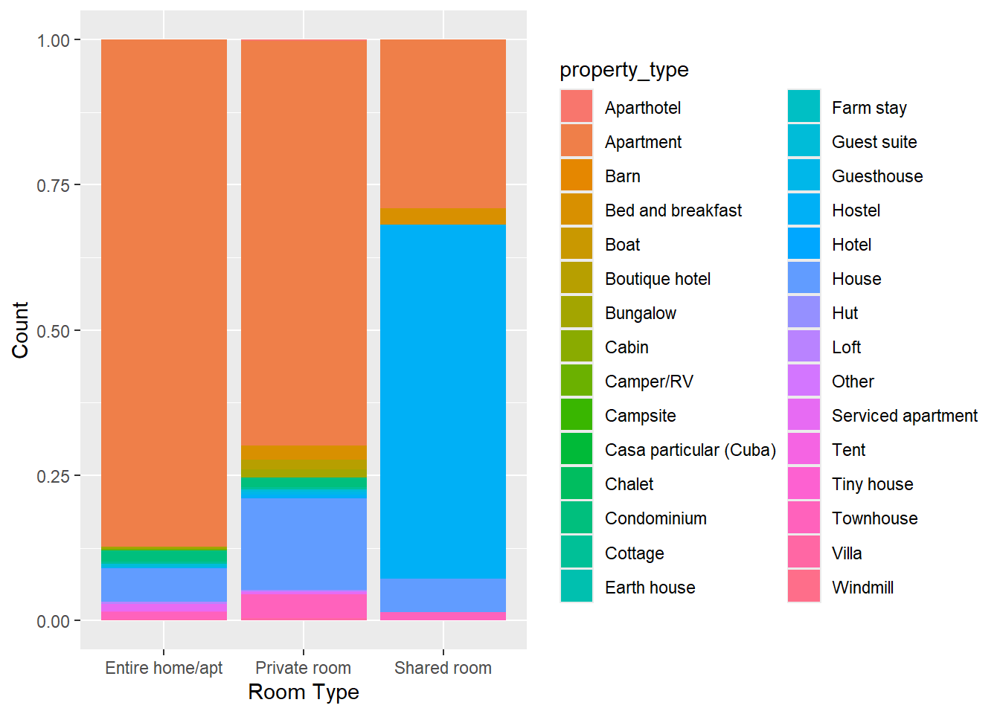

What we get is a **proportional stacked bar chart**. It is no longer using counts but *proportions*. Note a proportion is expressed as 0.1 etc. but a percentage is expressed as a ratio of 100 e.g. 10%. And because it is proportions, we can now *compare* across `room_type`. Fro example, we can see that `Shared Room` is very different as it seems to be mainly Hostels: it has far higher proportions of these than `Entire Apt/House` and `Private Room`.

We need to clean the chart up however:

1.  **Change the y axis:** from “count” to “Proportion” (this is a quirk of ggplot that it does not change this).
2.  **Change the legend**: from the raw variable name “Property_type” to “Property Type”.
3.  **Change y axis to percentages:** We could also change the y axis to percentages using the `scales` package. If you look it up, you should be able to work it out quickly. I’ve given an example below.

``` r
listings %>% 
ggplot(aes(x = room_type, fill = property_type)) +
  geom_bar(position = "fill") + 
  scale_y_continuous(labels = scales::percent) + # Point 3
  labs(title = "My Title",
       fill = "Property Type", # Point 2
    x = "Room Type", 
    y = "Proportion") # Point 1
```

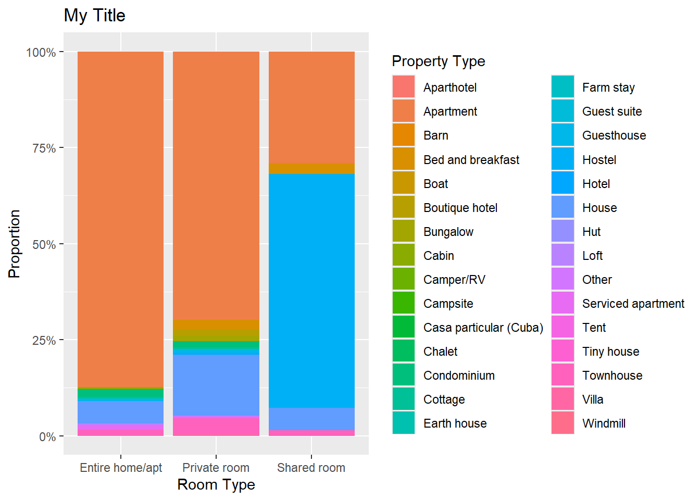 <span id="grouped-stacked-bar-chart"></span>

##### 5.2.0.2.3 2.3. Grouped Stacked Bar Chart

Finally, we can use `position = dodge` to create a grouped bar chart: It positions the columns directly *beside* one another, instead of on top of each other like a stacked bar chart: which makes it easier to compare individual values - notice we are back to counts again.

``` r
listings %>% 
ggplot(aes(x = room_type, fill = property_type)) +
  geom_bar(position = "dodge") + 
    labs(title = "My Title",
       fill = "Property Type", # Point 2
    x = "Room Type", 
    y = "Proportion") # Point 1
```

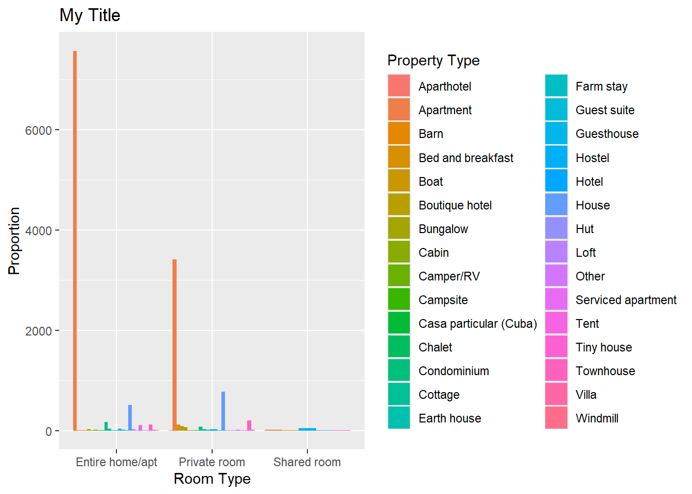

This probably is not the best example of a grouped bar chart. See R for Data Science 3.8 for better ones - or just create one in Excel or look them up online. What it does tell us is we have more Apartments in our dataset than any other, predominantly in the `Entire Homes/Apartments` group.

<span id="summary"></span>

##### 5.2.0.2.4 2.4. Summary

You should find this helpful. Firstly, because social science surveys have a lot of *factor* variables normally; secondly, you might have to plot *two* factor variables (as we did in Example 2: Proportional Stacked Bar Chart and Example 3: Grouped Stacked Bar Charts). And finally, you might have to *compare* them (as we did in Example 2: Proportional Stacked Bar Chart).

If you have worked through this Lab Tutorial, you should now have a good, initial understanding of the `ggplot` package; data types and appropriate plots; and plotting numeric and factor variables.

Again remember the following will be very useful:

1.  [R for Data Science: particularly Chapter 3](https://r4ds.had.co.nz/data-visualisation.html)
2.  And the [R Graphics Cookbook](https://r-graphics.org/) is a good resource.

[4 Tutorial 3: Data Visualisation - Numeric variables](https://qdaworkbook.netlify.app/tutorial-3-data-visualisation---numeric-variables) [6 Tutorial 5: Inference - the t-test](https://qdaworkbook.netlify.app/tutorial-5-inference---the-t-test)
