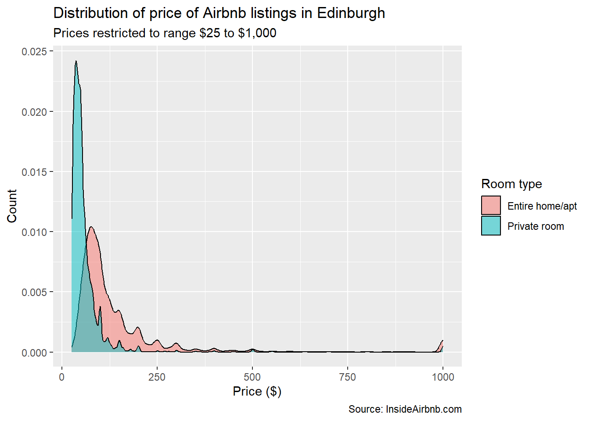

> Source: [Chapter 6 Tutorial 5_ Inference - the t-test _ QDA Lab Workbook.html](../Tutorial/Tutorial_5/Chapter%206%20Tutorial%205_%20Inference%20-%20the%20t-test%20_%20QDA%20Lab%20Workbook.html) · [Original workbook page](https://qdaworkbook.netlify.app/tutorial-5-inference-%2D-the-t-test)

<span id="tutorial-5-inference---the-t-test"></span>

# 6 Tutorial 5: Inference - the t-test

We are moving on from Data Visualisation to Inference now. So we’ll create a new RMarkdown document.

As always, delete out the boilerplate text and keep the setup chunk. We’ll use this to set up. Type or copy the following into your setup chunk:

``` r
###############################
# 1. load all libraries
###############################

library(tidyverse)

###############################
# 2. read in your data 
###############################
listings <- read_csv("listings_edinburgh.csv") 
```

``` text
## Rows: 14014 Columns: 10
## ── Column specification ──────────────────────────────────────────────────────────────────────────
## Delimiter: ","
## chr (4): name, neighbourhood_cleansed, property_type, room_type
## dbl (6): accommodates, bathrooms, bedrooms, beds, price, review_scores_rating
## 
## ℹ Use `spec()` to retrieve the full column specification for this data.
## ℹ Specify the column types or set `show_col_types = FALSE` to quiet this message.
```

``` r
###############################
# 3. select what variables you need 
###############################

# we don't need to do this.

###############################
# 4. filter your variables
###############################

# Tutorial 2: filter out any extreme or questionable values
listings <- filter(listings,
                   price >= 25, price <= 1000, bathrooms <= 5) %>%
  drop_na(price, bedrooms, bathrooms) # and drop any missing (na) values

###############################
# 5. coerce and relabel your variables
###############################

# Tutorial 1: coerce room_type from character to factor
listings <- mutate(listings,
                   room_type = factor(room_type),
                   property_type = factor(property_type))
```

Note this time, I have outlined how to structure your setup chunk for data cleaning:

1.  Load all required libraries
2.  Read in your data
3.  Create a subset of the data: select what variables you need from the dataset i.e. are required to answer your Research Question. And save it to an new object variable e.g. listings_subset. We want to work non-destructively in case we need our original dataset.
4.  Filter your variables
5.  Coerce and relabel your variables. Note there is no relabeling done above but you will definitely need to do this in your project. See Lecture 2 and Workshop 4 for more details.

This is how you would use your setup chunk to set up your data project. There is a template on Moodle (see Weeks 5-6) to help you further: one which is an example from the lecture; and one which is a basic, template to help you structure your data cleaning for your project.

OK, we have now set up and can make a start on the Tutorial 5 exercises.

Remember it will help you to label your chunks at this stage as it will force you to think about what you are doing. Some of you ask when you should add another chunk. I would add as many as you think necessary and probably to add more than less.

However, labeling your chunks will help you think more clearly about this: what you are doing and why you are doing it.

Note: your RMarkdown document will not Knit if you use the same label twice: imagine I call one chunk: `data cleaning`. And then the next chunk, also `data cleaning`. That’s two different code chunks with the same label. The RMarkdown document won’t knit now. So be careful.

<span id="q1.-exclude-shared-rooms"></span>

## 6.1 Q1. Exclude Shared Rooms

Here I will add my comments and explain to myself what’s going on. You should be doing the same at this point.

First, I will create a subset:

``` r
# 1. Create a new subset of your data which excludes shared rooms.

listings_subset <- filter(listings, room_type != "Shared room") 

# or using the tidyverse pipeline method (recommended):
listings_subset <- listings %>% 
  filter(room_type != "Shared room") 
```

Then I’m going to check that it worked:

``` r
# quick check: use visualisation skills from last week
listings_subset %>%
  ggplot(aes(price, room_type)) + # x axis = numeric variable, y = factor variable
  geom_boxplot()
```


It worked. 😊

Note: we can also use the levels() function to check how many levels we have.

`room_type` is a factor variable with three categories or what R calls ‘levels’. When we filter out ‘*Shared Rooms*’ the actual *Shared Rooms* category or ‘level’ will still remain - just with zero values or observations in it.

We can use the [`droplevels()`](https://rdrr.io/r/base/droplevels.html) function to get rid of *any categories* with zero observations. So the [`filter()`](https://dplyr.tidyverse.org/reference/filter.html) function removes the *observations* but the [`droplevels()`](https://rdrr.io/r/base/droplevels.html) function removes the actual *category*.

``` r
listings_subset <- listings %>% 
  filter(room_type != "Shared room") %>% 
  droplevels() # drops any category (or 'level') with zero values

# quick check
levels(listings_subset$room_type)
```

``` text
## [1] "Entire home/apt" "Private room"
```

All correct! 😊 So we can move on…

**Why do we create a subset in the first place?** *Because our aim in this tutorial is to use a t-test.*

A t-test compares *two* means. To compare two means though it needs a factor variable with two categories. This is what produces the two means: just like we could produce two boxplots. Boxplots are for numeric variables only but we can produce more than one by using a factor variable.

It’s the same for a t-test: we calculate the mean (which is for numeric variables only) but we want to produce more than one (and so we use a factor variable).

However, the t-test only compares *two* means. So this is what we need for a t-test:

1.  a numeric variable;

2.  and a factor variable with only *two categories* (or what R calls, `levels).`

And for our situation, let’s apply this:

- A mean is a numeric descriptive statistic (we’ll use `price`)

- We’ll use the mean `price` between our factor variable, `room_type` (entire home, private room, shared room)

- But `room_type` has *three* levels: this will result in *three* means not two

- We cannot do a t-test therefore. 😕

OK instead we’ll just exclude one of the categories (for this tutorial only) so we can run our t-test. And we’ll choose to omit the category `Shared rooms`.

Notice as before I am explaining to myself:

- *What* I am doing (creating a subset)

- *How* I am doing it (not much since I explained this in the tutorial; you should put in more here)

- *Why* I am doing it (so I can carry out a t-test)

Make sure you are doing this as part of your learning proces.. And remember to use header levels to outline your document.

<span id="q2-show-the-mean-and-standard-deviation-of-price-by-room_type"></span>

## 6.2 Q2: Show the mean and standard deviation of `price` by `room_type`

Here we are using descriptive summary statistics. These only describe our sample *not the population*. And our goal in this tutorial is to move from the sample to being able to say things about the population.

So why are we using descriptive statistics initially therefore?

Because we proceed from *sample* to population in quantitative data analysis. So before we proceed to see whether a relationship exists in the population, that is:

- between `pric`e (like the dependent variable: the thing we want to explain) and `room_type` (like the independent variable: the thing we want to explain `price` with or by);

- or, as in the assessment/lecture example, between earnings (dependent variable) and sex (independent variable)

*… first*, *we want to see if exists in our sample* And, if it does, what that relationship looks like: was it as we hypothesised initially in our Research Question? Is it a strong/weak relationship etc.? We would do this with descriptive statistics and, as with last week, plots.

Here we’ll just use some summary statistics (rather than plots). However, you now have the skills to produce plots as well - as you did above when I did a quick check with a boxplot (Tutorial 4). We could also have used a density plot as we did in Tutorial 3:

``` r
listings_subset %>%
  ggplot(aes(price, fill = room_type)) +
  geom_density(alpha = 0.5) +
  labs(title = "Distribution of price of Airbnb listings in Edinburgh",
       subtitle = "Prices restricted to range $25 to $1,000",
       x = "Price ($)",
       y = "Count",
       caption = "Source: InsideAirbnb.com",
       fill = "Room type")
```



So you can see how we are applying the skills of previous tutorials now (Tutorials 2-4). Check the assessment example on Moodle to see how it proceeds here at this stage.

If we can establish this relationship *in our sample first*, we will have more evidence and information to proceed onto the next stage: *testing* whether this relationship is a ‘true’ one that exists in the population and that is not merely an accident of the sample we have collected (sampling error). This is called an *inferential test:* the inference part means using our sample (our data) to make statements about our population of interest.

- *Inferential:* So we have about 14,000 observations or Airbnb listings in Edinburgh and our population of interest might perhaps be: all of the Airbnb listings in Scotland, say. This is just a practice dataset though so it will not have been randomly sampled or meant for this purpose. Our lecture example is better: here we use a sample of the UK working age population (16-64) to make statements about the *entire* UK working age population. When we use or sample to make statements about the population of interest in our Research Question, we are using inference.

- *Testing:* we are testing the *dependent-key independent variable* relationship of our Research Question: the DV-Key IV pair. Do we have a relationship as we thought and was suggested by the literature?

So the purpose of inferential testing is to test our **Research Question: the DV-Key IV pair** and see whether this relationship holds not just in our sample (our dataset) but *also* in our population of interest.

We will pretend then that our Research Question is:

“The price of an Airbnb listing can be predicted primarily by the type of room (`room_type`), even when controlling for other characteristics like number of rooms, review scores and even property type.”

And we’ll use this from now on as we’ll move into modelling this.

So this research question has a DV-Key IV relationship inscribed into it:

1.  Dependent Variable (DV): Price.
2.  Key Independent Variable (Key IV): Room Type

So we calculated summary statistics for this (Lab Tutorial 2). We visualised this relationship (Lab Tutorial 5). That was the **Visualise** stage: QDA 2. Now we move on to QDA 3: **Test.** This is our inferential test.

OK, the next Tutorial question asks us to remind ourselves of these summary statistics: this time, it asks us to calculate the standard deviation, which we didn’t do before back in Lab Tutorial 2 (it was just min, max, mean and median):

``` r
# 2. Create a table showing the mean and standard deviation of price by room_type.

listings_subset %>%
  group_by(room_type) %>%
  summarise(mean(price), sd(price)) 
```

``` text
## # A tibble: 2 × 3
##   room_type       `mean(price)` `sd(price)`
##   <fct>                   <dbl>       <dbl>
## 1 Entire home/apt         143.        156. 
## 2 Private room             61.2        78.3
```

You can explain to yourself the *what* and *how* since I have explained the *why.*

Note: we could name our new aggregate variables if we wanted the table to be clearer. We don’t need to accept the defaults:

``` r
listings_subset %>%
  group_by(room_type) %>%
  summarise(mean_price = mean(price), standard_deviation = sd(price))
```

``` text
## # A tibble: 2 × 3
##   room_type       mean_price standard_deviation
##   <fct>                <dbl>              <dbl>
## 1 Entire home/apt      143.               156. 
## 2 Private room          61.2               78.3
```

We could also use the kable() function to make them look nicer:

``` r
library(knitr) # remember all libraries get loaded in the setup chunk

listings_subset %>%
  group_by(room_type) %>%
  summarise(mean_price = mean(price) , standard_deviation = sd(price)) %>% 
   kable() 
```

| room_type       | mean_price | standard_deviation |
|-----------------|------------|--------------------|
| Entire home/apt | 142.58211  | 155.84659          |
| Private room    | 61.23363   | 78.31543           |

*Notes:*

- *Note 1:* You can find out more about formatting tables [here](https://rmarkdown.rstudio.com/lesson-7.html) and [here](https://cran.r-project.org/web/packages/kableExtra/vignettes/awesome_table_in_html.html), for example. We could also have tidied up our table by rounding it two decimal places (say) and giving it a title.

- *Note 2:* remember to check the R Markdown file: in the curly brackets, I had to suppress the output and the warning message. I also used another argument: results=‘asis’. You can find out more about this [here](https://bookdown.org/yihui/rmarkdown-cookbook/results-asis.html) and, more simply, [here](https://rmarkdown.rstudio.com/lesson-7.html) (again).

  

I asked you to interpret the standard deviation here. I would suggest (re)doing the Key Reading (Fogarty) and revisit the lecture material.

We know the mean is affected by outliers. Let’s briefly look at the effect of outliers on the standard deviation - since this is the average distance from the mean. Will this be affected too by outliers? Let’s change our original filtering criteria: beforehand we excluded any outliers over \$1000. We’ll be much more strict and exclude any outliers over \$500 now:

``` r
# recreate changes but exclude outliers: price <=$500

# Tutorial 1: coerce room_type from character to factor
listings2 <- mutate(listings,
                    room_type = factor(room_type))

# Tutorial 2: filter out any extreme or questionable values: price <=$500
listings2 <- filter(listings2,
                    price >= 25, price <= 500, bathrooms <= 5) %>%
  drop_na(price, bedrooms, bathrooms) # and drop any missing (na) values

listings_subset2 <- listings2 %>% 
  filter(room_type != "Shared room") 

# check standard deviation now
listings_subset2 %>%
  group_by(room_type) %>%
  summarise(mean(price), sd(price)) # makes more sense
```

``` text
## # A tibble: 2 × 3
##   room_type       `mean(price)` `sd(price)`
##   <fct>                   <dbl>       <dbl>
## 1 Entire home/apt         119.         76.3
## 2 Private room             56.1        39.7
```

You can see that the standard deviation makes much more substantive sense here. Obviously if the mean is pulled away from the median by outliers, then the distribution around the mean (i.e. the standard deviation) *will also be affected*. This is another reason why we want to think about our outliers initially in the data cleaning process (Tutorials 1-2).

<span id="q3-t-test-price-room-type"></span>

## 6.3 Q3: T-Test: Price & Room Type

So in Q2, we have established the relationship exists in our sample: price *does* vary by room type. This is a fairly trivial example but in other instances it might not be so obviously clear.

Now we have done so, we can test whether this relationship is a ‘true’ one that exists in the population e.g. the population of Scottish or UK Airbnbs not just our sample from Edinburgh. It might be that the Edinburgh sample we have drawn is unusual in some way, for example.

There is only one line of code in this answer *but it is the underlying process which is more important*. Please revisit the lecture material and do the Key Reading therefore.

Here the Tutorial question is: *Q3. Is the difference in price statistically significant?*

``` r
# 3. Is the difference in price statistically significant?
t.test(price ~ room_type, data = listings_subset)
```

``` text
## 
##  Welch Two Sample t-test
## 
## data:  price by room_type
## t = 40.419, df = 13419, p-value < 2.2e-16
## alternative hypothesis: true difference in means between group Entire home/apt and group Private room is not equal to 0
## 95 percent confidence interval:
##  77.40350 85.29348
## sample estimates:
## mean in group Entire home/apt    mean in group Private room 
##                     142.58211                      61.23363
```

**You tutor will ask additional questions in the tutorial to support the understanding of this process of inferential testing:** See slides (which has the questions) and the answers below:

**Key Questions**: What does this output actually *mean*? Here are some questions for you to answer:

1.  The t test can compare two means. Which two means are we comparing?

2.  What is our null hypothesis (H0)?

3.  How do we know if price is statistically significant?

4.  What does it mean if it is?

Let’s think through these now:

**Q1**. **Which two means are we comparing?**

The mean price of *Entire Home/Appt* and *Private Room*. Because the t test is an *inferential* statistic: the *population* mean of both. The t-test enables us test: does this relationship exist at the level of the popualtion (not just within our sample of Airbnb listings in our dataset)

**Q2. What is our null hypothesis (H0)?**

Our null hypothesis most often translates to: *no* *difference* or *no* *relationship*.

Our null hypothesis here therefore is that the population mean price of the “Entire home/apt” listings is the same as the “Private room” listings i.e. *there <u>is</u> no difference* in price between the two room types. This would be the same in the gender pay gap example:

*H0: There is no difference in earnings between males and females.*

**Q3. How do we know if price is statistically significant?**

We check the conventional p-value cut off of 0.05.

- If it *is* 0.05 or below, we reject the null hypothesis. The result is statistically significant. This means the relationship is a ‘real’ or ‘true’ relationship in our actual population of interest and not just in our sample.

- If it is greater than 0.05, we fail to reject the null hypothesis (=‘accept’) and conclude that the relationship we detected in our sample was due to sampling error.

What about our example?

The p-value is substantially lower than our threshold of 0.05. In, fact, it is very close to zero.

- The closer we get to 0, the more evidence we have to reject the hull hypothesis.

- The closer we get to 1, the more and more we fail to reject (i.e. ‘accept’) the null hypothesis (of no difference).

**The Logic of Falsification: the strange language of inference**

We don’t positively *accept* anything: we either *reject* the null hypothesis (what we normally want) or we *fail to reject* the null (what we don’t want). Why? Because we are dealing with probabilities (p-values) and not certainties. If we reject the null hypothesis for example, it’s because we have better *evidence* for the alternative. But we cannot be 100% certain.

So can we be wrong about the null hypothesis? Yes:

- If we reject it *when it’s actually true*, this is called a Type I error (a ‘false positive’).

- If we fail to reject it (=‘accept’), *when it’s actually false*, this is called a Type II error (a ‘false positive’).

And this caution extends to the strange language e.g. ‘fail to reject’. We don’t know or have data on our entire population. If we did, we wouldn’t have to use a sample. But we do. As as result, we use probabilities.

It also extends to the strange logic of hypothesis testing: the *null* and *alternative* hypothesis. This is based on the idea of falsification in science (see Karl Popper).

- **Example:** are all swans white?

We can look for years and count millions of them. Does that prove our hypothesis that all swans are white? No. We just need to find *one* black swan (not millions of white ones) and that will disprove it.

In other words, we employ the logic of falsification: in science (and in social science) we cannot prove anything definitively and with 100% certainty (white swans) but we can go the other way and look for evidence which *falsifies* it (black swans). This is the logic employed here. This is why we set up our null hypothesis (white swans) - the thing we don’t want as it were - and seek evidence to the contrary (black swan).

At what point do we do this however? At what point, do we adjudicate that we have evidence to the contrary (black swan or our *alternative hypothesis*)

This is where the p-value comes in. The convention in the social sciences is the cut-off 0.05. Below (closer to 0), we reject the null hypothesis. Above (closer to 1), we fail to reject (=‘accept’) it.

**Q4. What does it mean if price is statistically significant?**

Statistical significance means that this is a ‘true’ or ‘real’ relationship in the wider population of interest that was not picked up by accident in our sample (sampling error). This is what we are doing in the **QDA: Test** stage: Is the relationship in our Research Question (DV-Key IV) a ‘true’ or ‘real’ relationship in the wider population of interest; or did we just happen to pick this up through sampling error.

So in our example then, we can therefore *reject the null hypothesis* (of ‘no difference’) and conclude that the difference in price is statistically significant: there *is* a relationship between `room_type` and `price` that exists in the wider population of interest.

When you read **Fogarty Ch 9: Hypothesis Testing,** you will see examples of this in action. This is the best way of learning this process.

<span id="overall-summary-lab-tutorial-5"></span>

## 6.4 Overall Summary: Lab Tutorial 5

The whole structure and purpose of Lab Tutorial 5 was to conduct an inferential test: this is the **QDA 3: Test** stage.

**You will need to do this in your assignment too**: between your dependent variable (Outcome) and main independent variable of interest (Predictor). Think about what that *is* (from your Research Question) and what inferential test you can apply.

1.  using the t test to compare two means: this is why we excluded Shared Rooms from Room Type, so we had two levels (Q1);

2.  this is why we examined the descriptive statistics for each level: the mean of price for Entire Appt/Home and Private Room (Q2). We saw they were plainly different.

But descriptive statistics relate to our sample only. We want to see whether this difference exists *in the population* (of all Airbnb’s in Scotland or UK say, not just in Edinburgh)

3\. We then proceeded with an inferential test to see whether this difference was a ‘true’ difference in the population (Q3). 

4\. All of our concepts were brought to bear in Q3 therefore and interpreting the R output:

- What was our null hypothesis?

- What were we looking for in order to interpret whether the difference in means was statistically significant?

- What could we then say in relation to the null hypothesis?

You will need to apply this to your assessment so look at the example on Moodle to see how that works. In terms of how that all fits into what we have done so far…

<span id="formative-assessment"></span>

## 6.5 Formative Assessment

Ideally, at this point, this is what you should have done so far. And this is the **overall process** we are learning:

1.  Used literature to contextualise your Research Question.

2.  Formed a Research Question (RQ):

- This should have an Outcome (dependent) variable and a main Predictor (a key independent variable)

Example: Is there a gender \[key independent variable\] pay \[dependent\] gap in the UK in 2019?

3.  Described the variables: Used descriptive summary statistics to describe your model variables in your sample
4.  From your RQ, visualised the relationship in your sample between:

- your Outcome (dependent) variable and your main Predictor (key independent variable)

- Does it look as if it actually exists in the sample at this point?

5\. Test whether it exists in the population: you have explored whether the key relationship in the RQ exists in the sample. You now test whether that exists in the population of interest, using an inferential test.

- Inference is what makes us able to make statements about the population of interest (economically active women in the UK) and not just our sample (the economically active women women in our sample).

Now you have explored the main (bivariate) relationship. **You are at the halfway point. This is where we will be after Lab Tutorials 5-6.**

Why don’t we stop here? We can see there is a relationship between:

- Price and Room Type (tutorial example)

- or Earnings and Sex (lecture example)

Surely we are done and can go back and answer our Research Question?

**Next steps:** **Tutorials 7-10**

After next week’s Lab Tutorial 6 (ANOVA and correlation). we’ll move onto modelling.

Yes, we might have a statistically significant relationship between our Dependent and Key Independent variable (as described in our Research Question (RQ). But this relationship might be spurious (it disappears when we add in the ‘real’ independent variable) or there may be confounding factors (the relation isn’t as big/small as we think once we add in other pay-related variables like what sector you work in, your education etc.). See Lecture 1 which covers this and the overall purpose of modelling.

Therefore, we need to model that main relationship (DV-Key IV in our RQ) by adding **control variables** e.g. as above, like what sector you work in, your education etc. In doing so, we move from bivariate to multivariable analysis. This will be the focus of Tutorial 7-10.

For next week however, we focus on two other inferential tests (*ANOVA* and *correlation*) so please make sure you do the reading if you have not already.

[5 Tutorial 4: Data Visualisation - Numeric and Factor variables](https://qdaworkbook.netlify.app/tutorial-4-data-visualisation---numeric-and-factor-variables) [7 Tutorial 6: Inference - ANOVA and Correlation](https://qdaworkbook.netlify.app/tutorial-6-inference---anova-and-correlation)
