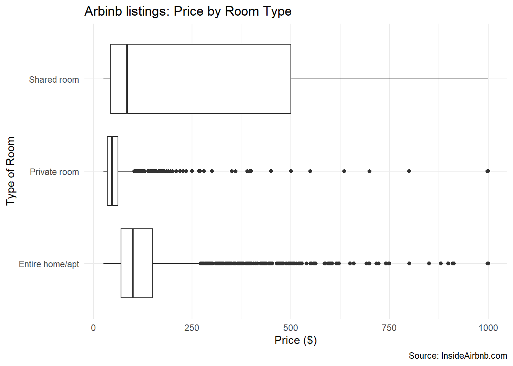

> Source: [Chapter 7 Tutorial 6_ Inference - ANOVA and Correlation _ QDA Lab Workbook.html](../Tutorial/Tutorial_6/Chapter%207%20Tutorial%206_%20Inference%20-%20ANOVA%20and%20Correlation%20_%20QDA%20Lab%20Workbook.html) · [Original workbook page](https://qdaworkbook.netlify.app/tutorial-6-inference-%2D-anova-and-correlation)

<span id="tutorial-6-inference---anova-and-correlation"></span>

# 7 Tutorial 6: Inference - ANOVA and Correlation

We’ll first set up and use the same R Markdown document as before in Tutorial 5, since they both cover Inference.

If you do want to create a separate R Markdown document, remember to recreate the changes made in previous tutorials:

Hopefully by now, you are labeling your chunks, and using the arguments in curly brackets appropriately (e.g. `include= FALSE` or `echo = FALSE`).

Note that **Q1-Q2** repeat previous material however I have covered it here, with some further elements.

<span id="tutorial-6"></span>

## 7.1 Tutorial 6

We’re going to go back to using `listings` again - our original dataset. And not `listings_subset`. This was only so we could have a factor (`room_type`) with two levels (`entire home/appt` and `private room`) and thus run a t-test.

We have two other inferential lests to cover in this Lab Tutorial: ANOVA and correlation.

<span id="q1-boxplot-of-price-and-room-type"></span>

### 7.1.1 Q1: Boxplot of price and room type

We will create a boxplot showing how price varies by room type. Remember to use `listings` not `listings_subset`.

I want to show both code (input) and plot (output) as below so I’ll leave the curly brackets empty - meaning it will default to `echo=TRUE`. If you wanted, you could name your chunk also e.g. *Q1 price and room type.*

``` r
  listings %>% 
  ggplot(aes(price, room_type)) +
  geom_boxplot() +
  labs(title = "Arbinb listings: Price by Room Type",
       x = "Price ($)",
       y = "Type of Room",
       caption = "Source: InsideAirbnb.com") +
  theme_minimal()
```



Note that this time I have added another layer: a [`theme()`](https://ggplot2.tidyverse.org/reference/theme.html) layer. See Tutorial 4 R Markdown for more detail and try to experiment with the different themes available.

**Questions: Interpreting Boxplots**

1.  Does `price` vary by `room_type`?

2.  How do you know? What are you looking at in the boxplot?

3.  Are the boxes the same width? What does the box represent?

4.  What are the whiskers or lines each side of the box?

5.  What are the dots outsider the whiskers?

If you are still unsure of how to interpret a boxplot, see *Fogarty, Chapter 8: Visualising Data (especially, Box Plots pp. 130-131)*. You can also discuss with your Lab colelagues and Tutors.

<span id="create-a-table-showing-the-minimum-maximum-mean-and-standard-deviation-of-price-by-room_type."></span>

### 7.1.2 2. Create a table showing the minimum, maximum, mean and standard deviation of price by room_type.

Produce and interpret the statistics:

``` r
listings %>%
  group_by(room_type) %>%
  summarise(min_price = min(price), max(price), mean(price), sd_price = sd(price)) 
```

``` text
## # A tibble: 3 × 5
##   room_type       min_price `max(price)` `mean(price)` sd_price
##   <fct>               <int>        <int>         <dbl>    <dbl>
## 1 Entire home/apt        25         1000         143.     156. 
## 2 Private room           25         1000          61.2     78.3
## 3 Shared room            25         1000         243.     276.
```

How would we explain the standard deviation in each case?

For Private Room, to take one example: we would add and subtract the standard deviation from the mean. This would give us one standard deviation (68% of the observations) away from the mean on both sides. This is greater than the actual mean so this is very large. So large that substracting it makes no substantive sense.

This the case for all the room types. We looked at this previously by filtering our price variable below \$500, and saw the effect on the standard deviation and how it made much more sense.

Shared Rooms looks nonsensical to me. By using descriptive statistics and plots (it looked very odd in Tutorials 3-4), we are doing initial exploratory data analysis, flagging issues before we proceed on to modelling. You should make sure you explore your main variables before modelling them.

**Optional Exercise only:** Filter values of price below \$500 as we did last time but this time for `listings` rather than `listings_subset`. This means the category `Shared rooms` is now included again. Recalculate the statistics

1.  Does the standard deviation make more sense?

2.  What about Shared Rooms?

<span id="anova-test-is-the-difference-in-price-statistically-significant"></span>

### 7.1.3 3. ANOVA test: Is the difference in price statistically significant?

Last week, we ran a t-test. However, a t-test can only work on a factor with two levels (like `room_type` last week in `listings_subset`). Now we have moved back to `listings`*,* `room_type` has three levels again. So what we inferential test can we use?

The answer is an analysis of variance (ANOVA) test.

The analysis of variance tests:

- H0: the null hypothesis (H0) that all groups (here *room types*) have equal means (i.e. are all the same price).

- H1: The alternative hypothesis (H1) is that not all group means are equal (at least one of them is not equal).

Note that not *all* groups have to be different; just one of them.

``` r
# We could do this either using the aov() function or the lm() function.
aov(price ~ room_type, data = listings) %>% 
  summary()
```

``` text
##                Df    Sum Sq  Mean Sq F value Pr(>F)    
## room_type       2  21888594 10944297   607.1 <2e-16 ***
## Residuals   13644 245970112    18028                   
## ---
## Signif. codes:  0 '***' 0.001 '**' 0.01 '*' 0.05 '.' 0.1 ' ' 1
```

``` r
# or 
listings %>%
  aov(price ~ room_type, data = .) %>%
  summary()  
```

``` text
##                Df    Sum Sq  Mean Sq F value Pr(>F)    
## room_type       2  21888594 10944297   607.1 <2e-16 ***
## Residuals   13644 245970112    18028                   
## ---
## Signif. codes:  0 '***' 0.001 '**' 0.01 '*' 0.05 '.' 0.1 ' ' 1
```

We’re looking for the p-value.

Here, the p-value is very small (\<2e-16), which is far less than the typical cut off significance level of 0.05. So we reject the null hypothesis that the population means are equal.

<span id="correlation-test-what-is-the-correlation-between-price-and-review_score_rating"></span>

### 7.1.4 4. Correlation test: What is the correlation between price and review_score_rating?

A correlation test requires two numeric variables. Here we are using price and review_score_rating.

``` r
# # Pearson's product-moment correlation
cor.test(~ price + review_scores_rating, data = listings) 
```

``` text
## 
##  Pearson's product-moment correlation
## 
## data:  price and review_scores_rating
## t = -8.4085, df = 11134, p-value < 2.2e-16
## alternative hypothesis: true correlation is not equal to 0
## 95 percent confidence interval:
##  -0.09786506 -0.06095252
## sample estimates:
##         cor 
## -0.07943602
```

``` r
# Or alternative 'tidyverse' way
listings %>%
  cor.test(~ price + review_scores_rating, data = .) 
```

``` text
## 
##  Pearson's product-moment correlation
## 
## data:  price and review_scores_rating
## t = -8.4085, df = 11134, p-value < 2.2e-16
## alternative hypothesis: true correlation is not equal to 0
## 95 percent confidence interval:
##  -0.09786506 -0.06095252
## sample estimates:
##         cor 
## -0.07943602
```

Firstly, we’re looking for the correlation coefficient: you will find it under `cor`. There is a very weak negative correlation: -0.07943602

<span id="q4.-is-the-correlation-statistically-significant"></span>

### 7.1.5 Q4. Is the correlation statistically significant?

**Remember statistical significance means something specific: i.e.** has not come about by random error when sampling. And relates to the *population* not the sample.

For statistical signficance, we’re looking for the p-value. You will find this in the third line of output. Ask your Tutors or Lab Colleagues if unsure.

We have very low p value: \< 2.2e-16. So it’s statistically significant.

So we reject the Null Hypothesis. Instead of *no difference* (like a t-test and ANOVA), the Null Hypothesis for a correlation test is of *no relationship*. What this look like? Well, if we visualised these two numeric variables using a scatterplot and drew a line of best fit through the points, the line would *not have any slope*: it would be flat. Because a slope indicates some sort of relationship between two numeric variables.

We can reject this therefore and say there *is* a ‘true’ or ‘real’ relationship in the population, one that was not picked up by random sampling error (i.e. statistically significant). Even if that relationship is a very weak, negative one.

<span id="what-might-explain-the-results"></span>

### 7.1.6 5. What might explain the results?

We would surely expect a positive correlation: as price goes up so does the review rating… or higher quality listings (review) are more expensive (price)

But it’s the opposite. *Why?*

**Some thoughts… Price may set people’s expectations… which may influence the rating.**

- **Higher prices:** Perhaps people find more expensive listings less good value for money, and hence lower their score. *Higher prices make them more strict in their reviews.*

- **Lower prices.** Perhaps a cheap room means you don’t expect much and then are pleasantly surprised if it’s better than you thought? *Lower prices make them more lenient in their reviews.*

This will become important when we model. If Review Scores is not measuring what we think it is (quality) but something else (*Price* or its effect on expectations) we are going to run into a problem. We’ll note this for now however and return to it: Review Scores is not measuring what we thought it was. And we’ll explore the problem when we start doing our diagnostic tests.

<span id="inferential-tests"></span>

### 7.1.7 Inferential tests

Lab Tutorial 6 concludes our two Lab Tutorials on **inferential tests** (Lab Tutorials 5-6). So we have three inferential tests for the purpose of this course:

1.  t-test (numeric and factor variable)

2.  ANOVA (numeric and factor variable)

3.  correlation (numeric and numeric)

The choice between a t-test and an ANOVA test is whether the factor has more than two levels (ANOVA) or only two (t-test).

Make sure you go over *Fogarty’s Chapter 9 on Hypotheses Testing* and are familiar with the steps outlined there:

1.  Develop an alternative hypothesis and then the null hypothesis
2.  Decide on the statistical test (t-test, ANOVA or correlation) and level of significance at which to reject/accept the null hypothesis (usually 0.05 in the social sciences)
3.  Compute the p-value (in R Studio)
4.  Make your decisions whether to accept or reject the null hypothesis

<span id="putting-it-together"></span>

### 7.1.8 **Putting it together**

Notice the overall process: we visualise the relationship *in our sample* first (Tutorials 3-4):


Then, having **visualised** the relationship in the sample (and using **descriptive statistics** to expand upon this), we **test** that relationship in the population, from which our sample derives:

``` text
##                Df    Sum Sq  Mean Sq F value Pr(>F)    
## room_type       2  21888594 10944297   607.1 <2e-16 ***
## Residuals   13644 245970112    18028                   
## ---
## Signif. codes:  0 '***' 0.001 '**' 0.01 '*' 0.05 '.' 0.1 ' ' 1
```

This is is why we repeated the boxplot (**Q1**) \[and descriptive statistics in **Q2**\] before we tested the relationship in the population **(Q3**). So you could see this *as a process (**Q1-Q3**)*

You should be able to apply this process to your assignment:

**QDA 2**: **Visualising** the key relationship (DV-Key IV) *in the sample* (Tutorial 3-4), backed up with Descriptive Statistics (Tutorial 2) before proceeding onto…

**QDA 3**: **Testing** this relationship *in the population* (Tutorials 5-6).

[6 Tutorial 5: Inference - the t-test](https://qdaworkbook.netlify.app/tutorial-5-inference---the-t-test) [8 Tutorial 7: Model Building](https://qdaworkbook.netlify.app/tutorial-7-model-building)
