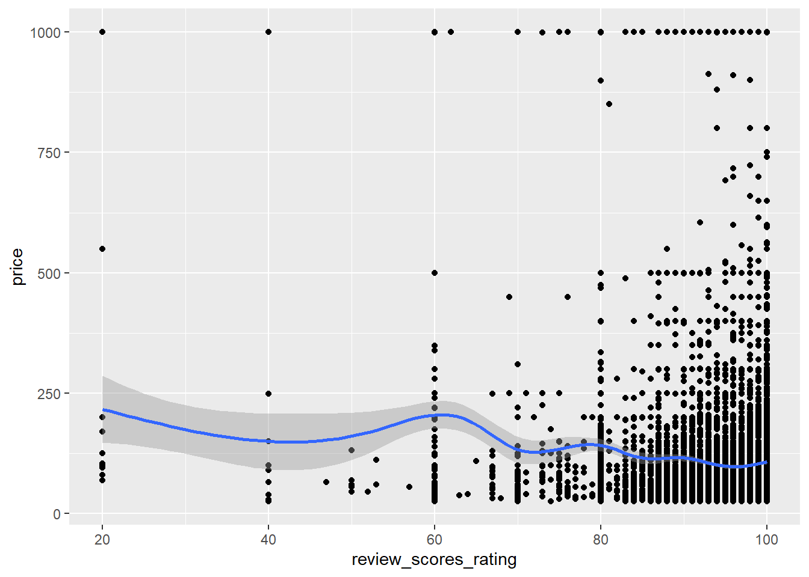
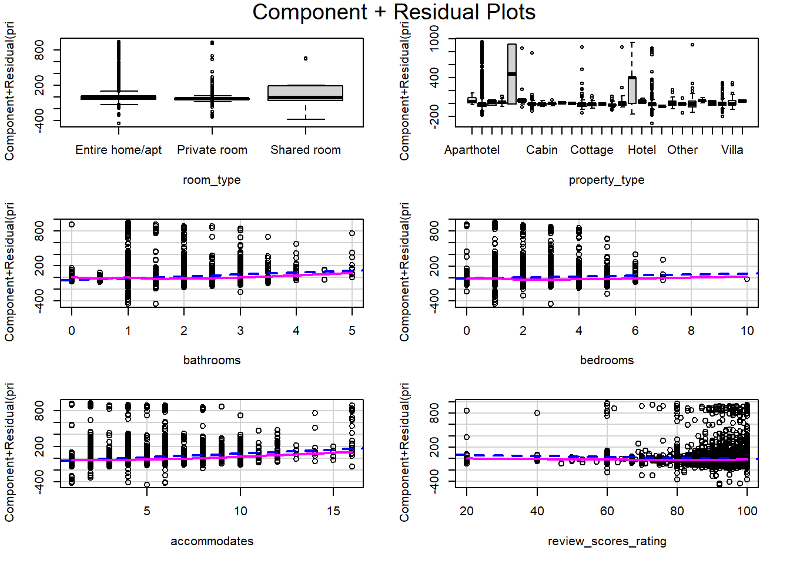
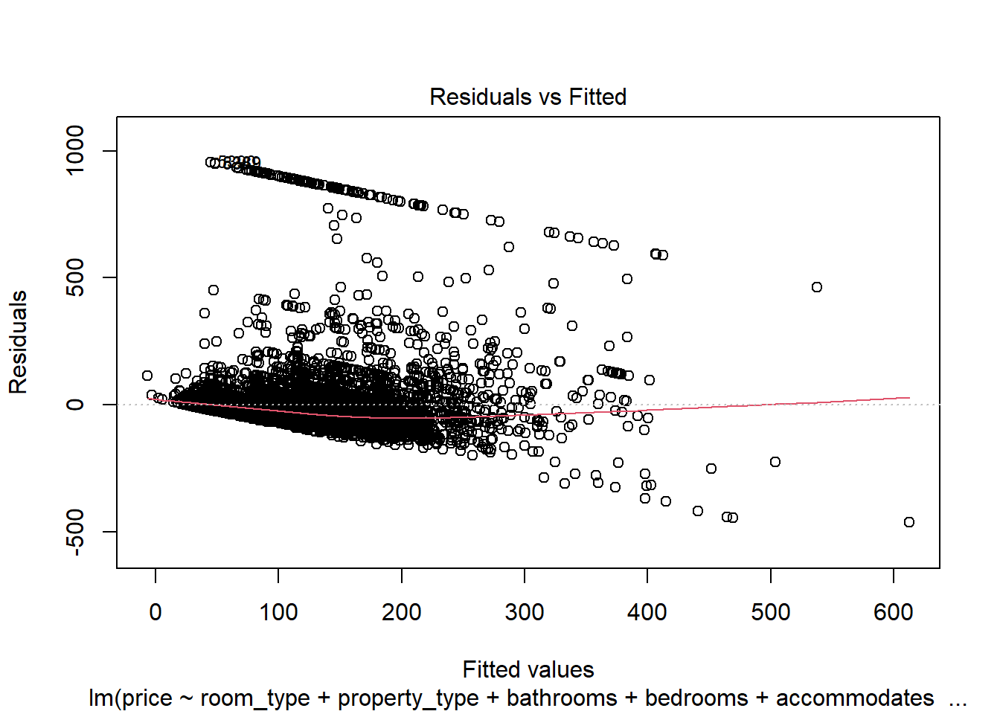
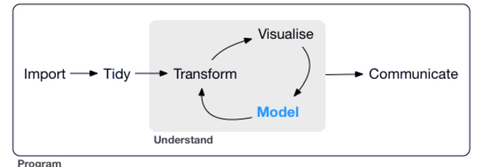

> Source: [Chapter 9 Tutorial 8_ Diagnostics I _ QDA Lab Workbook.html](../Tutorial/Tutorial_8/Chapter%209%20Tutorial%208_%20Diagnostics%20I%20_%20QDA%20Lab%20Workbook.html) · [Original workbook page](https://qdaworkbook.netlify.app/tutorial-8-diagnostics-i)

<span id="tutorial-8-diagnostics-i"></span>

# 9 Tutorial 8: Diagnostics I

I’m going to ask you create a new RMarkdown document. Diagnostics is really a subject in itself so we need a new document for our final two Lab Tutorials to keep this separate.

After you create a new document and delete out the text, use the setup chunk as usual. Here is the code, which you can copy over: note we have two libraries now at this point.

``` r
library(tidyverse)
library(texreg) # for comparing models

# Read in data
listings <- read_csv("listings_edinburgh.csv") # remember your file name and path may be different
```

``` text
## Rows: 14014 Columns: 10
## ── Column specification ──────────────────────────────────────────────────────────────────────────
## Delimiter: ","
## chr (4): name, neighbourhood_cleansed, property_type, room_type
## dbl (6): accommodates, bathrooms, bedrooms, beds, price, review_scores_rating
## 
## ℹ Use `spec()` to retrieve the full column specification for this data.
## ℹ Specify the column types or set `show_col_types = FALSE` to quiet this message.
```

``` r
# Filtering
listings <- filter(listings,
                   price >= 25, price <= 1000, bathrooms <= 5) %>%
  drop_na(price, bedrooms, bathrooms)

# Coercing 
listings <- mutate(listings,
                   room_type = factor(room_type),
                   property_type = factor(property_type))
```

We’ll use **model 4** for practice. Recreate this now:

``` r
# Model 4:
m4 <- listings %>%
  lm(price ~ room_type + property_type + bathrooms + bedrooms + accommodates + review_scores_rating,
     data = .) 
```

Note this will have the ‘old’ property_variable: the one with 30 categories and ‘Aparthotel’ as the reference. That’s fine and the one we’ll be using in these final Lab Tutorials.

Having already interpreted our model previously and noticed some strange things going on, we can now start running diagnostics tests on the model itself. I’ll follow the order given in the *Tutorial Exercises*. So firstly, checking *influential outliers*.

<span id="diagnostics-1.-influential-outliers"></span>

## 9.1 Diagnostics 1. Influential Outliers

Remember *outliers* mean residuals that are far from the predicted line (or model); and *influential* means ‘leverage’: those points that affect or ‘pull’ the regression line, thus affecting the slope coefficient estimates.

Hence, the diagnostic plot for this is a **residual vs leverage plot**.

``` r
# Diagnostics 1: Influential Outliers

# 1. checking for outliers: model 4
listings %>%
  lm(price ~ room_type + property_type + bathrooms + bedrooms + accommodates + review_scores_rating,
     data = .)  %>%
  plot(which = 5)
```

``` text
## Warning: not plotting observations with leverage one:
##   3177, 10181, 10323, 11063
```

``` text
## Warning in sqrt(crit * p * (1 - hh)/hh): NaNs produced
## Warning in sqrt(crit * p * (1 - hh)/hh): NaNs produced
```

``` r
# or, alternatively, we could simply pipe the created object to the plot() function
# this is what I'll use from now on
m4 %>% plot(which = 5) # model 4
```

``` text
## Warning: not plotting observations with leverage one:
##   3177, 10181, 10323, 11063
## Warning: NaNs produced
## Warning: NaNs produced
```

> 原 HTML 引用的插图未包含在所提供的文件中，故保留此缺图说明。 The figure referenced by the original HTML is absent from the supplied files: Diagnostics 1\_ Influential Outliers-1.png

  

Remember as in the lecture, a Cook’s distance of 0.5 is high and over 1 is extreme.

We have three points in a warning message where the leverage is high. We might want to check these and see if there is anything unusual.

``` r
## Warning: not plotting observations with leverage one:
##   3177, 10181, 10323, 11063
```

However, not all high-leverage observation are influential outliers. And that is what we are looking for.

We have two points or influential observations flagged within the Cook’s distance margins: observations 8 and 8651. They are close to the value of 1 so we should have a look.

If you have listings saved in your Global Environment (Window Pane 3), we can type in `View(listings)` into the console. Or we can click on the icon to the right of the dataset in the Global Environment (Window Pane 3).

Now we can look at the `listings` data and scroll down to the relevant observations. With a dataset of thousands of observations, however, it can be quite onerous.

One approach is to convert the row names into an actual column:

``` r
# two arguments: my dataset, what I want the new column to be called
listings_rows <- rownames_to_column(listings, "row_numbers") # eases checking influential outliers
```

Now, as you look at the dataset in View() mode you can use the filter icon. And in our new `row_numbers` column, you can type in the number of the relevant observation: when I type in **8** and **8651**, I notice they are both boats.

Moving from the first column (`row_numbers`) to the third (`property_type`), I’ll filter by `Boat`: and see there are only two boats in our entire dataset - **8** and **8651**. There are some unusual combinations of values as well (look at their prices and reviews scores, for example). I’m really checking for mistakes in the data at this point: something wrongly coded or that just seems wrong and completely unrealistic - as we did in the first few tutorials.

This looks ‘real’ data to me so I would be inclined to keep it in. You don’t want to exclude data just because it is unusual or extreme necessarily (e.g. very high earners when you’re studying income inequality, say) or just because it is flagged in the `residual vs leverage` plot. You want to *use* the plot to approach the data points analytically and then make an analytical choice you can describe and justify to a marker (or reviewer). Remember these are *diagnostic* plots so they form the basis of an informed choice rather than just giving you the ‘answer’. Look at the relevant section in Fogarty book (Chapter 12) for example, where he discusses a student’s choice to exclude Russia from a regression model on military spending and treat it separately as a case study.

Just for the purposes of illustration, I’m going to exclude these two boats. I’m then going to compare the model **without** them to the model **with** them and see if the coefficients change massively.

``` r
# filter out the two boats
listings_rows  <-  listings_rows %>% 
  filter(row_numbers!= "8" & row_numbers!= "8651")

# rerun model 4 now and save it to a new object
m4_drop <- listings_rows %>%
  lm(price ~ room_type + property_type + bathrooms + bedrooms + accommodates + review_scores_rating,
     data = .)  
```

I could use the [`summary()`](https://rdrr.io/r/base/summary.html) function to compare the coefficients, scrolling up and down:

``` r
m4 %>% summary()
```

``` text
## 
## Call:
## lm(formula = price ~ room_type + property_type + bathrooms + 
##     bedrooms + accommodates + review_scores_rating, data = .)
## 
## Residuals:
##     Min      1Q  Median      3Q     Max 
## -462.56  -41.84  -15.25    6.76  954.26 
## 
## Coefficients:
##                                     Estimate Std. Error t value Pr(>|t|)    
## (Intercept)                         151.1247    44.5045   3.396 0.000687 ***
## room_typePrivate room               -37.0034     2.9529 -12.531  < 2e-16 ***
## room_typeShared room                 49.5639    24.6947   2.007 0.044767 *  
## property_typeApartment              -48.7627    41.5311  -1.174 0.240370    
## property_typeBarn                   -33.1418    92.7949  -0.357 0.720986    
## property_typeBed and breakfast      -34.3451    43.3877  -0.792 0.428619    
## property_typeBoat                   404.8867    92.7762   4.364 1.29e-05 ***
## property_typeBoutique hotel          87.3322    57.0103   1.532 0.125584    
## property_typeBungalow               -43.3518    43.5134  -0.996 0.319133    
## property_typeCabin                  -56.9533    79.4416  -0.717 0.473439    
## property_typeCamper/RV              -49.3464    52.8368  -0.934 0.350355    
## property_typeCasa particular (Cuba) -39.4537   124.4219  -0.317 0.751177    
## property_typeChalet                 -47.3541   124.4775  -0.380 0.703639    
## property_typeCondominium            -49.5949    42.5582  -1.165 0.243905    
## property_typeCottage                -58.0914    45.1230  -1.287 0.197981    
## property_typeFarm stay              -60.5103   124.4619  -0.486 0.626852    
## property_typeGuest suite            -68.6998    45.2117  -1.520 0.128661    
## property_typeGuesthouse             -10.5242    46.8743  -0.225 0.822358    
## property_typeHostel                 230.7452    48.4050   4.767 1.89e-06 ***
## property_typeHotel                  -16.3124    79.4403  -0.205 0.837309    
## property_typeHouse                  -53.3429    41.6653  -1.280 0.200476    
## property_typeHut                    -98.8207   124.4469  -0.794 0.427166    
## property_typeLoft                   -40.2966    46.0214  -0.876 0.381263    
## property_typeOther                  -59.3696    54.5149  -1.089 0.276154    
## property_typeServiced apartment     -40.7662    43.2438  -0.943 0.345852    
## property_typeTent                    -4.6000    66.9066  -0.069 0.945188    
## property_typeTiny house             -40.6799    92.7909  -0.438 0.661102    
## property_typeTownhouse              -49.9928    42.0822  -1.188 0.234867    
## property_typeVilla                  -25.5313    46.6938  -0.547 0.584541    
## property_typeWindmill               -10.5103   124.4619  -0.084 0.932703    
## bathrooms                            30.2166     2.7274  11.079  < 2e-16 ***
## bedrooms                              8.1562     2.4012   3.397 0.000685 ***
## accommodates                         12.9835     1.0727  12.103  < 2e-16 ***
## review_scores_rating                 -0.8495     0.1651  -5.146 2.70e-07 ***
## ---
## Signif. codes:  0 '***' 0.001 '**' 0.01 '*' 0.05 '.' 0.1 ' ' 1
## 
## Residual standard error: 117.3 on 11102 degrees of freedom
##   (2511 observations deleted due to missingness)
## Multiple R-squared:  0.1893, Adjusted R-squared:  0.1868 
## F-statistic: 78.53 on 33 and 11102 DF,  p-value: < 2.2e-16
```

``` r
m4_drop %>% summary()
```

``` text
## 
## Call:
## lm(formula = price ~ room_type + property_type + bathrooms + 
##     bedrooms + accommodates + review_scores_rating, data = .)
## 
## Residuals:
##     Min      1Q  Median      3Q     Max 
## -444.24  -41.77  -15.18    6.79  954.21 
## 
## Coefficients:
##                                     Estimate Std. Error t value Pr(>|t|)    
## (Intercept)                         150.5208    44.4442   3.387 0.000710 ***
## room_typePrivate room               -36.8718     2.9490 -12.503  < 2e-16 ***
## room_typeShared room                 49.6428    24.6612   2.013 0.044140 *  
## property_typeApartment              -48.8194    41.4747  -1.177 0.239186    
## property_typeBarn                   -33.3626    92.6689  -0.360 0.718840    
## property_typeBed and breakfast      -34.4263    43.3288  -0.795 0.426900    
## property_typeBoutique hotel          87.3972    56.9329   1.535 0.124790    
## property_typeBungalow               -43.4496    43.4544  -1.000 0.317386    
## property_typeCabin                  -56.8582    79.3338  -0.717 0.473576    
## property_typeCamper/RV              -49.1988    52.7651  -0.932 0.351143    
## property_typeCasa particular (Cuba) -39.5217   124.2529  -0.318 0.750434    
## property_typeChalet                 -46.9546   124.3085  -0.378 0.705641    
## property_typeCondominium            -49.6577    42.5004  -1.168 0.242668    
## property_typeCottage                -58.1990    45.0617  -1.292 0.196544    
## property_typeFarm stay              -60.4772   124.2929  -0.487 0.626573    
## property_typeGuest suite            -68.7073    45.1503  -1.522 0.128101    
## property_typeGuesthouse             -10.4281    46.8107  -0.223 0.823717    
## property_typeHostel                 230.7292    48.3393   4.773 1.84e-06 ***
## property_typeHotel                  -16.3352    79.3324  -0.206 0.836866    
## property_typeHouse                  -53.4888    41.6088  -1.286 0.198638    
## property_typeHut                    -98.8117   124.2779  -0.795 0.426580    
## property_typeLoft                   -40.2936    45.9589  -0.877 0.380652    
## property_typeOther                  -59.4434    54.4409  -1.092 0.274906    
## property_typeServiced apartment     -40.7995    43.1850  -0.945 0.344802    
## property_typeTent                    -4.5835    66.8157  -0.069 0.945310    
## property_typeTiny house             -40.4418    92.6649  -0.436 0.662533    
## property_typeTownhouse              -50.1433    42.0251  -1.193 0.232826    
## property_typeVilla                  -25.6712    46.6304  -0.551 0.581970    
## property_typeWindmill               -10.4772   124.2929  -0.084 0.932824    
## bathrooms                            30.1352     2.7238  11.064  < 2e-16 ***
## bedrooms                              8.5226     2.3989   3.553 0.000383 ***
## accommodates                         12.9086     1.0714  12.049  < 2e-16 ***
## review_scores_rating                 -0.8452     0.1649  -5.127 3.00e-07 ***
## ---
## Signif. codes:  0 '***' 0.001 '**' 0.01 '*' 0.05 '.' 0.1 ' ' 1
## 
## Residual standard error: 117.1 on 11101 degrees of freedom
##   (2511 observations deleted due to missingness)
## Multiple R-squared:  0.1881, Adjusted R-squared:  0.1857 
## F-statistic: 80.36 on 32 and 11101 DF,  p-value: < 2.2e-16
```

Or I could use the `texreg` package:

*Statistical models*

|   | Model 1 | Model 2 |
|----|----|----|
| (Intercept) | 151.12<sup>\*\*\*</sup> | 150.52<sup>\*\*\*</sup> |
|   | (44.50) | (44.44) |
| room_typePrivate room | -37.00<sup>\*\*\*</sup> | -36.87<sup>\*\*\*</sup> |
|   | (2.95) | (2.95) |
| room_typeShared room | 49.56<sup>\*</sup> | 49.64<sup>\*</sup> |
|   | (24.69) | (24.66) |
| property_typeApartment | -48.76 | -48.82 |
|   | (41.53) | (41.47) |
| property_typeBarn | -33.14 | -33.36 |
|   | (92.79) | (92.67) |
| property_typeBed and breakfast | -34.35 | -34.43 |
|   | (43.39) | (43.33) |
| property_typeBoat | 404.89<sup>\*\*\*</sup> |   |
|   | (92.78) |   |
| property_typeBoutique hotel | 87.33 | 87.40 |
|   | (57.01) | (56.93) |
| property_typeBungalow | -43.35 | -43.45 |
|   | (43.51) | (43.45) |
| property_typeCabin | -56.95 | -56.86 |
|   | (79.44) | (79.33) |
| property_typeCamper/RV | -49.35 | -49.20 |
|   | (52.84) | (52.77) |
| property_typeCasa particular (Cuba) | -39.45 | -39.52 |
|   | (124.42) | (124.25) |
| property_typeChalet | -47.35 | -46.95 |
|   | (124.48) | (124.31) |
| property_typeCondominium | -49.59 | -49.66 |
|   | (42.56) | (42.50) |
| property_typeCottage | -58.09 | -58.20 |
|   | (45.12) | (45.06) |
| property_typeFarm stay | -60.51 | -60.48 |
|   | (124.46) | (124.29) |
| property_typeGuest suite | -68.70 | -68.71 |
|   | (45.21) | (45.15) |
| property_typeGuesthouse | -10.52 | -10.43 |
|   | (46.87) | (46.81) |
| property_typeHostel | 230.75<sup>\*\*\*</sup> | 230.73<sup>\*\*\*</sup> |
|   | (48.41) | (48.34) |
| property_typeHotel | -16.31 | -16.34 |
|   | (79.44) | (79.33) |
| property_typeHouse | -53.34 | -53.49 |
|   | (41.67) | (41.61) |
| property_typeHut | -98.82 | -98.81 |
|   | (124.45) | (124.28) |
| property_typeLoft | -40.30 | -40.29 |
|   | (46.02) | (45.96) |
| property_typeOther | -59.37 | -59.44 |
|   | (54.51) | (54.44) |
| property_typeServiced apartment | -40.77 | -40.80 |
|   | (43.24) | (43.19) |
| property_typeTent | -4.60 | -4.58 |
|   | (66.91) | (66.82) |
| property_typeTiny house | -40.68 | -40.44 |
|   | (92.79) | (92.66) |
| property_typeTownhouse | -49.99 | -50.14 |
|   | (42.08) | (42.03) |
| property_typeVilla | -25.53 | -25.67 |
|   | (46.69) | (46.63) |
| property_typeWindmill | -10.51 | -10.48 |
|   | (124.46) | (124.29) |
| bathrooms | 30.22<sup>\*\*\*</sup> | 30.14<sup>\*\*\*</sup> |
|   | (2.73) | (2.72) |
| bedrooms | 8.16<sup>\*\*\*</sup> | 8.52<sup>\*\*\*</sup> |
|   | (2.40) | (2.40) |
| accommodates | 12.98<sup>\*\*\*</sup> | 12.91<sup>\*\*\*</sup> |
|   | (1.07) | (1.07) |
| review_scores_rating | -0.85<sup>\*\*\*</sup> | -0.85<sup>\*\*\*</sup> |
|   | (0.17) | (0.16) |
| R<sup>2</sup> | 0.19 | 0.19 |
| Adj. R<sup>2</sup> | 0.19 | 0.19 |
| Num. obs. | 11136 | 11134 |

\*\*\*p \< 0.001; \*\*p \< 0.01; \*p \< 0.05

  

The differences are minimal. And I’m reassured that my choice to leave `Boats` in was justified.

**Optional Activity** You could try this same process now with the four points of high leverage: 3177, 10181, 10323, 11063.

1.  Look at their values: are they mistakes or mistakenly coded?
2.  Is there some sort of combination of extreme or strange values?
3.  If they are just unusual but are ‘real’ data what will you do? Make sure you are actually thinking things through.
4.  Run the model without the four observations and then compare.

As in the lectures, influential outliers *are often not a serious problem* in large datasets. If you had a small dataset of 30 data points, it might be more of an issue and require further consideration (again, see the Fogarty example above where a small dataset of countries was the case).

<span id="diagnostics-2-non-linearity"></span>

## 9.2 Diagnostics 2: Non-linearity

One of the assumptions of OLS regression is that the independent variables have a linear relationship to the dependent variable. This might not necessarily always be the case: take *age*, for example, and *cognitive ability*. We make great cognitive leaps in early childhood and then it tends to level off in the adult years or even decline later on. Describes in these terms, there is a non-linear relationship between the dependent variable (cognitive ability) and the independent variable (age). Again, thinking through things substantively and reading the literature can help here. As can the prior exploratory data analysis of your own data (e.g. scatterplots).

This time we’ll use a `residual vs fitted` plot. We’re focusing on the red line which, ideally, should be flat:

``` r
# model 4: residuals vs fitted values plot
m4 %>% plot(which = 1)
```


  

Note: For clarity of output here and below, I have suppressed the warning messages using `warning=FALSE` in the curly brackets.

The red line seems to curve down and up, giving some evidence for non-linearity.

This plot will give you a more general diagnostic at the level of the model as a whole: what variables are the issue, however? There are other ways we could approach this:

1.  A scatterplot of the dependent and independent variables, assuming the latter is numeric. This is because a scatterplot is appropriate for numeric variables.

``` r
listings %>% 
  ggplot(aes(x = review_scores_rating, y = price)) +
  geom_point() +
  geom_smooth()
```



It doesn’t look particularly linear to me but I don’t trust my eyes.

2.  We can also use the `car` (companion to applied regression) library and use its `component + residual plots`. See Fogarty, Ch. 12. You will have to install this first. Make sure you do this in the console not in your R Markdown document.

``` r
# install.packages("car")
library(car)
```

Then load the `car` library. Remember it is bad practice to load your libraries anywhere except in your setup chunk. I’m just doing this here for convenience.

And then run the plots for **Model 4**. It will automatically run it for each independent variable:

``` r
crPlots(m4)
```



In my *html* output, these plots are actually quite small and difficult to read. When you Knit the file, open it up in the *browser* (ask your Tutors if unsure). You get then Zoom in via the browser settings (e.g. 110% zoom).

Again, we’ll focus on the numeric variables. The blue dashed line is what a linear relationship would look like. The purple/pink line is where it veers off.

There seems to be evidence of some non-linearity in all four numeric variables. Again, try to think substantively about why that might be. For example: for bedrooms, perhaps a linear relationship to price might hold for 1-2 bedrooms but when you suddenly have more than that, say, perhaps price is less incremental? There is a ceiling effect and price doesn’t add much more after a certain number of bathrooms or very little. I don’t know the area so I’m unsure myself but when you do your assignment, you’ll want to think through things in substantive terms and not just in the technical terms of merely running the tests.

3.  Finally, we’ll run the Ramsey RESET test. This is a statistical test for the presence of non-linearity (and omitted variables bias - see Fogarty, Ch. 12 again) which can be more helpful than just “eyeballing” a plot.

First, install the `lmtest` package *in the console* if you haven’t already. Do *not* do this in your RMarkdown document.

``` r
# install.packages ("lmtest")
library(lmtest)
```

As above, remember we should load all libraries in the setup chunk. I’ll adjust this later…

This test compares our **Model 4** with a model using squared and cubed versions of the fitted values. These are ways of correcting non-linearity (look up power transformations, for example): a squared independent variable can correct a non-linear, quadratic relationship to the dependent variable, for example.

So essentially, if using squared and cubed versions *improves* the fit of the model, then we have evidence of non-linearity.

Formally, the null hypothesis in this test is that there is no significant difference in the amount of variance explained in the outcome variable. In very simply terms however, that we have no issues.

``` r
resettest(m4, power = 2:3, type = "fitted")
```

``` text
## 
##  RESET test
## 
## data:  m4
## RESET = 70.954, df1 = 2, df2 = 11100, p-value < 2.2e-16
```

We see that the *p-value \< 0.05*, so we reject the null and conclude that we *do* violate the assumption of correct functional form.

**To summarise then:** We can use the following approach to testing for non-linearity:

1.  **Plot-based:** a residual vs fitted plot (and possibly checking particular independent variables with (a) scatterplots of the numeric independent and dependent variables (b) component + residual plots)
2.  **Test-based:** using the Ramsey RESET test

The is one of the critical BLUE assumptions, so this is a serious issue for our model and means our coefficients estimates will be biased.

<span id="diagnostics-3-distribution-of-residuals"></span>

## 9.3 Diagnostics 3: Distribution of residuals

Next we test for the distribution of the residuals. Remember our assumption here is that our residuals should be *normally distributed*.

The Q-Q plot helps us to compare what this would look like with our actual model. Ideally, all our residual would lie along or fairly close to the 45 degree line, which indicates normally distributed residuals

``` r
# model 4: Q-Q plot
listings %>%
  lm(price ~ room_type + property_type + bathrooms + bedrooms + accommodates + review_scores_rating,
     data = .) %>%
  plot(which = 2) # gives us the Q-Q plot

# or
m4 %>% plot(which = 2)
```


  

It doesn’t look anywhere near normal.

At the moment, we are just doing an initial pass of diagnostic checks. Once we have a complete picture, we can start to think about what we need to do to solve some of these issues and to what extent they *can* be solved.

<span id="diagnostics-4-heteroscedasticity"></span>

## 9.4 Diagnostics 4: Heteroscedasticity

We’ll move on to the assumption of constant variance or homoscedasticity. Our residuals should be randomly distributed (which indicates homoscedasticity). The opposite of this is some sort of pattern or structure in the residuals: often this is a fanning out (or in) of the residuals, known as heteroscedasticity.

We’ll return to the `residuals vs fitted values` plot as in **Diagnostics 2 (Non-linearity)** above. Essentially, we’re looking for random noise in our residuals. There should be no pattern. In particular, there should be no increasing variance in the residuals over the range of our observations (fanning out of the residuals) or decreasing (fanning in). It should look random over this entire range, more or less. If not, it exhibits heteroscedasticity.

So firstly, let’s examine our residual vs fitted plot for any patterns, in particular any fanning in or out.

``` r
# 1. Residuals vs fitted plot
m4 %>% plot(which = 1)
```



There is definite fanning out: the variance of the residuals increases over the range of our observations.

The weird downward slope or ceiling may reflect that we filtered our observations (price \< 1000) to begin with (and at the bottom end too: price \>= 25).

As before, we can also use this in conjunction with a statistical test rather than just trusting our eyes. The Breusch-Pagan test will test for the presence of heteroscedasticity in our model.

Make sure you have the `lmtest` library loaded first.

``` r
library(lmtest) 

# make sure this is loaded in the very first chunk: the setup chunk at the very beginning of the document. I am doing it here only to draw your attention to the fact we need to use it i.e. install it and then load the library.
```

The null hypothesis of this test is that the residuals have constant variance - so no patterns in the residuals: the variance is constant (= random noise) rather than increasing or decreasing in any pattern or exhibiting any structure.

``` r
listings_rows %>%
  lm(price ~ room_type + property_type + bathrooms + bedrooms + accommodates + review_scores_rating, 
     data = .) %>%
  bptest() # runs the Breusch-Pagan test
```

``` text
## 
##  studentized Breusch-Pagan test
## 
## data:  .
## BP = 244.84, df = 32, p-value < 2.2e-16
```

``` r
# or 
m4 %>% bptest()
```

``` text
## 
##  studentized Breusch-Pagan test
## 
## data:  .
## BP = 255.61, df = 33, p-value < 2.2e-16
```

The p-value is very close to 0, therefore we reject the null hypothesis (of constant variance) and conclude that our model has heteroscedasticity.

Our approach to heteroscedasticity has therefore been:

1.  **Plot-based:** a residuals vs fitted plot
2.  **Test-based**: the Breusch-Pagan test

<span id="the-data-analysis-process"></span>

### 9.4.1 The Data Analysis Process

Remember you will always need to go through the process of initial descriptive statistics and visualization before you get the modelling:



Note: if link does not work, see <https://www.r-bloggers.com/2017/06/what-is-the-tidyverse/>

You will spot issues and problems long before you get to the modelling stage. For example:

1.  That is why we filtered the data in Tutorials 1-2 (preventing problems with outliers later on).
2.  We plotted the distribution of price (or dependent variable) and could see it was highly skewed (Tutorials 3-4).
3.  We plotted the relationships between price and review scores (Tutorials 3-4) and then conducted a correlation test (Tutorials 5-6). We knew that there was an issue with this relationship: it was negative not positive as we might have thought. Upon further consideration, we realised that we might not be just measuring the relationship between price and reviews: but also price (dependent variable) and, through reviews, people’s expectations based on the price (independent variable). Again, we have potentially spotted another issue which we’ll look at next time (endogeneity).

Make sure you follow the same patterns as the tutorials (i.e. the Data Analysis Process) when approaching your Assignment. Do *not* launch straight into modelling.

<span id="multicollinearity"></span>

## 9.5 5. Multicollinearity

Finally, we will look at multicollinearity. This potentially exists where our independent variables are highly correlated (measuring the same thing to a very large extent) or functions of each other.

There is a good chance our two variables `bedrooms` and `accommodates` might be measuring the same thing to a large extent. Since this is the case, we can try an initial correlation:

``` r
cor.test(listings$bedrooms, listings$accommodates)
```

``` text
## 
##  Pearson's product-moment correlation
## 
## data:  listings$bedrooms and listings$accommodates
## t = 176.84, df = 13645, p-value < 2.2e-16
## alternative hypothesis: true correlation is not equal to 0
## 95 percent confidence interval:
##  0.8292218 0.8394177
## sample estimates:
##       cor 
## 0.8343911
```

83.4% is a strong positive correlation so we might have issues here.

We can diagnose this more formally using the Variance Inflation Factor test (VIF). We are looking for values under 5 (see Lecture Slides and reading for more detail):

``` r
listings %>%
  lm(price ~ room_type + property_type + bathrooms + bedrooms + accommodates + review_scores_rating, 
     data = .) %>%
  vif()
```

``` text
##                          GVIF Df GVIF^(1/(2*Df))
## room_type            2.845159  2        1.298753
## property_type        2.100283 27        1.013837
## bathrooms            1.456734  1        1.206952
## bedrooms             3.619336  1        1.902455
## accommodates         3.847976  1        1.961626
## review_scores_rating 1.031293  1        1.015526
```

``` r
# or simply

m4 %>% 
  vif()
```

``` text
##                          GVIF Df GVIF^(1/(2*Df))
## room_type            2.845159  2        1.298753
## property_type        2.100283 27        1.013837
## bathrooms            1.456734  1        1.206952
## bedrooms             3.619336  1        1.902455
## accommodates         3.847976  1        1.961626
## review_scores_rating 1.031293  1        1.015526
```

None of our values are over 5 so we have no concerns. Since 83.4% is a strong positive correlation, it shows this has to be very high to be an issue for our model. Again, see the recommended reading (Fogarty, Chapter 12) for more on this and diagnostics generally.

<span id="summary-1"></span>

## 9.6 Summary

Finally, here is a summary of our approach so far:

<span id="diagnostics-1-influential-outliers"></span>

#### 9.6.0.1 **Diagnostics 1: Influential Outliers**

1.  **Plot-based**: a residual vs leverage plot

<span id="diagnostics-2-non-linearity-1"></span>

#### 9.6.0.2 **Diagnostics 2: Non-linearity**

1.  **Plot-based:** a residual vs fitted plot (and possibly checking particular independent variables with (a) scatterplots of the numeric independent and dependent variables (b) component + residual plots)
2.  **Test-based:** using the Ramsey RESET test

<span id="diagnostics-3-distribution-of-residuals-1"></span>

#### 9.6.0.3 **Diagnostics 3: Distribution of residuals**

1.  **Plot-based**: a Q-Q plot

<span id="diagnostics-4-heteroscedasticity-1"></span>

#### 9.6.0.4 **Diagnostics 4: Heteroscedasticity**

1.  **Plot-based:** a residuals vs fitted plot
2.  **Test-based**: the Breusch-Pagan test

<span id="diagnostics-5-multicollinearity"></span>

#### 9.6.0.5 **Diagnostics 5: Multicollinearity**

1.  **Test-based**: the VIF test

  

Drawing this all together, we can say that our model is not in good shape at this point. It has failed two of the critical BLUE assumptions\*: it does not have correct functional form (BLUE 2) and it does not have constant variance (BLUE 3). This means that our coefficients will be biased (BLUE 2: non-linearity) and also that our coefficients will be inefficient and our standard errors will be biased upwards (BLUE 3: heteroscedasticity), the latter meaning we are more likely to think our coefficients are statistically significant when, in fact, they are not.

\*See Key Reading: Fogarty, Chapter 12.

We have also tested for influential outliers. We have some influential outliers (flagged above 0.5 in the Cook’s Distance margins) but have checked this (and run a model without the two observations), it is not an issue, especially given we have a large dataset.

We tested for multicollinearity. We have some mild multicollinearity in our model but nothing to concern us.

And, finally, our residuals are not normally distributed, which means ‘we cannot be confident that the results we find from our sample data will apply to the population as a whole’ (see Fogarty, Chapter 12).

We have nearly completed our first pass of diagnostic testing. We still have to test for independence of our independent *variables* (BLUE 1: Tutorial 9/Question 1) and independence of our *observations* (BLUE 4: Tutorial 9/Question 2). These are not tests we can do in R (plots and statistical tests) but more conceptual checks. Once we have done so, we will have completed our first pass (it can go through several iterations). And once we have done so, we will attempt to deal with some of the issues flagged and then present a final robust model, if possible, which is able to answer our research question.

[8 Tutorial 7: Model Building](https://qdaworkbook.netlify.app/tutorial-7-model-building) [10 Tutorial 9: Diagnostics II](https://qdaworkbook.netlify.app/tutorial-9-diagnostics-ii)
