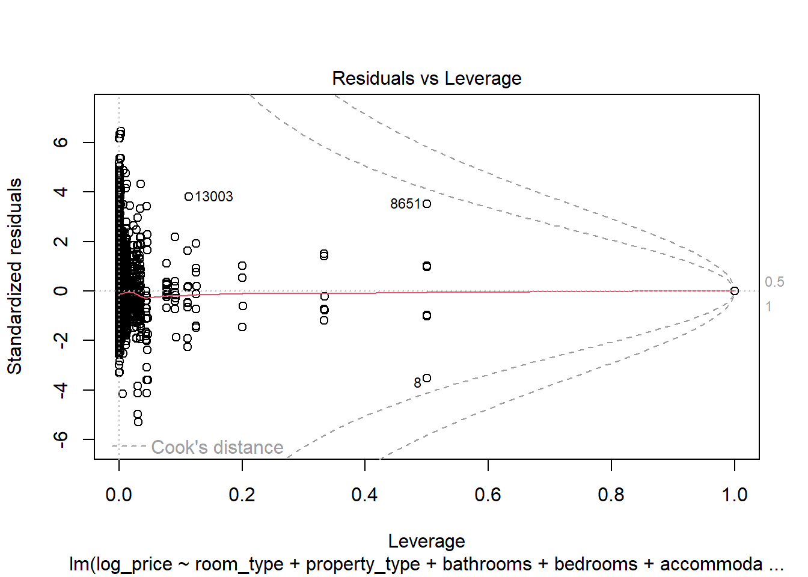
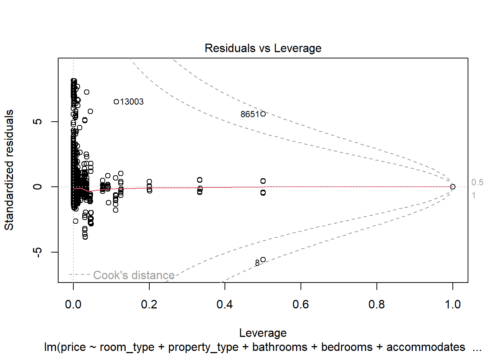
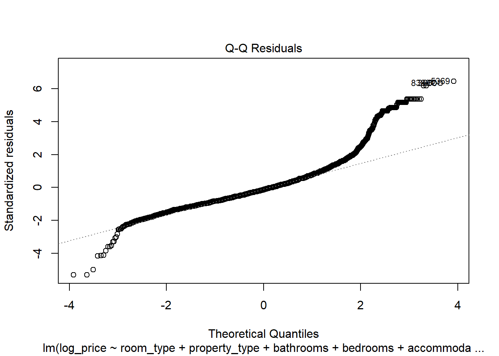
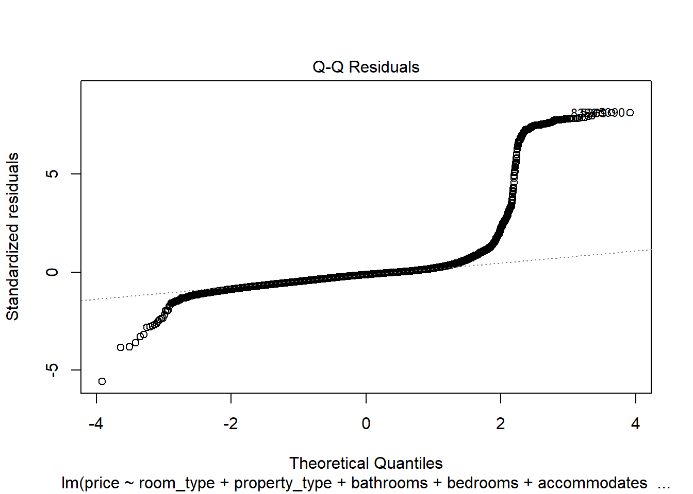
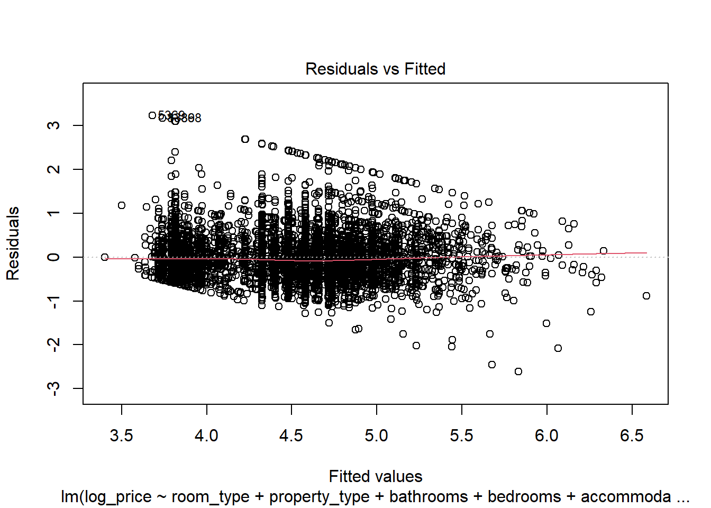

> Source: [Chapter 10 Tutorial 9_ Diagnostics II _ QDA Lab Workbook.html](../Tutorial/Tutorial_9/Chapter%2010%20Tutorial%209_%20Diagnostics%20II%20_%20QDA%20Lab%20Workbook.html) · [Original workbook page](https://qdaworkbook.netlify.app/tutorial-9-diagnostics-ii)

<span id="tutorial-9-diagnostics-ii"></span>

# 10 Tutorial 9: Diagnostics II

<span id="setting-up-load-tidyverse-and-recreate-our-listings-dataset"></span>

### 10.0.1 Setting up: load tidyverse and recreate our listings dataset

You can use the same R Markdown document or create an new one: it’s up to you.

There was a lot in the last Lab Tutorial so personally I’m going to create a new document. As usual, we need to do our preparatory work and data cleaning in the setup chunk.

If you are using the same document as last time, remember to clean up the code around our libraries: I’m now loading them in the setup chunk as I should have originally:

``` r
###########################
# 1. Load all our libraries.
###########################
# load tidyverse
library(tidyverse)

# load the car package in order to access the vif() function
library(car)

# load the lmtest package in order to access the Breusch-Pagan and Ramsay RESET tests
library(lmtest)


###############################
# 2. Read in the listings data.
###############################
listings <- read_csv("listings_edinburgh.csv")
```

``` text
## Rows: 14014 Columns: 10
## ── Column specification ──────────────────────────────────────────────────────────────────────────
## Delimiter: ","
## chr (4): name, neighbourhood_cleansed, property_type, room_type
## dbl (6): accommodates, bathrooms, bedrooms, beds, price, review_scores_rating
## 
## ℹ Use `spec()` to retrieve the full column specification for this data.
## ℹ Specify the column types or set `show_col_types = FALSE` to quiet this message.
```

``` r
###############################
# 3. And we'll recreate the previous changes made to the listings data.
###############################

# Filtering
listings <- filter(listings,
                   price >= 25, price <= 1000, bathrooms <= 5) %>%
  drop_na(price, bedrooms, bathrooms)

# Coercing 
listings <- mutate(listings,
                   room_type = factor(room_type),
                   property_type = factor(property_type))
```

If you were just loading your libraries throughout your RMarkdown document in the previous Lab Tutorial 8, make sure you cut and paste them into the setup chunk as above.

Make sure you are using the following model as per last time also: the one with the ‘old’ `property_type`

<span id="recreate-model-4"></span>

### 10.0.2 Recreate model 4:

``` r
m4 <- listings %>%
  lm(price ~ room_type + property_type + bathrooms + bedrooms + accommodates + review_scores_rating, 
     data = .) 
```

<span id="the-final-two-tests"></span>

### 10.0.3 The final two tests

Now we can start on the other diagnostics left to cover. Firstly, we have the two conceptual diagnostics tests:

1.  Exogenous variables: that our independent variables (columns) are independent: not of each other (multicollinearity) but now independent of the dependent variable.
2.  Autocorrelation: and independence of our observations (the rows)

See the lecture slides for dealing with these two issues. As before, there is no plot or statistical test so you will need to communicate to the marker that your have thought them through and how. And if there are no issues, that’s fine. But let the marker know this is the case and why.

We then drew up a plan in term of how to move towards a robust, final model (see slides). We had four issues to tackle:

1.  The need to drop review_scores_rating
2.  Non-linearity
3.  Heteroscedasticity
4.  Non-normality of our residuals

<span id="step-1-of-plan-correct-functional-form"></span>

### 10.0.4 Step 1 of Plan: Correct Functional Form

We proceeded to correct Functional Form based on the order of the Tutorial exercises. Having diagnosed the issue in Tutorial 8, we decided to transform the dependent variable.

We will now apply a logarithmic transformation to our dependent variable, `price`:

``` r
# transform the dependent variable in Model 4, saving it to a new object (m4_log)

m4_log <- listings %>%
  mutate(log_price = log(price)) %>%
  lm(log_price ~ room_type + property_type + bathrooms + bedrooms + accommodates + review_scores_rating, 
     data = .)
```

Firstly, we compared the two models: Model 4 *(m4)* and Model 4 with the logarithm of price *(m4_log)*:

``` r
# compare the two models

m4_log %>% summary()
```

``` text
## 
## Call:
## lm(formula = log_price ~ room_type + property_type + bathrooms + 
##     bedrooms + accommodates + review_scores_rating, data = .)
## 
## Residuals:
##     Min      1Q  Median      3Q     Max 
## -2.6144 -0.3137 -0.0732  0.2143  3.2250 
## 
## Coefficients:
##                                       Estimate Std. Error t value Pr(>|t|)    
## (Intercept)                          4.6293484  0.1897658  24.395  < 2e-16 ***
## room_typePrivate room               -0.5089081  0.0125911 -40.418  < 2e-16 ***
## room_typeShared room                -0.2210049  0.1052976  -2.099 0.035852 *  
## property_typeApartment              -0.6889051  0.1770875  -3.890 0.000101 ***
## property_typeBarn                   -0.4221799  0.3956750  -1.067 0.286001    
## property_typeBed and breakfast      -0.4246374  0.1850040  -2.295 0.021735 *  
## property_typeBoat                    0.7434151  0.3955952   1.879 0.060239 .  
## property_typeBoutique hotel          0.2080041  0.2430904   0.856 0.392201    
## property_typeBungalow               -0.6850102  0.1855401  -3.692 0.000224 ***
## property_typeCabin                  -0.7819791  0.3387370  -2.309 0.020989 *  
## property_typeCamper/RV              -0.7084393  0.2252947  -3.145 0.001668 ** 
## property_typeCasa particular (Cuba) -0.4112638  0.5305315  -0.775 0.438243    
## property_typeChalet                 -0.5973795  0.5307688  -1.125 0.260402    
## property_typeCondominium            -0.6923576  0.1814669  -3.815 0.000137 ***
## property_typeCottage                -0.6550217  0.1924033  -3.404 0.000665 ***
## property_typeFarm stay              -0.7654458  0.5307021  -1.442 0.149238    
## property_typeGuest suite            -0.8053694  0.1927812  -4.178 2.97e-05 ***
## property_typeGuesthouse             -0.4417022  0.1998708  -2.210 0.027130 *  
## property_typeHostel                  0.7274968  0.2063977   3.525 0.000426 ***
## property_typeHotel                  -0.2111909  0.3387310  -0.623 0.532984    
## property_typeHouse                  -0.7121243  0.1776598  -4.008 6.15e-05 ***
## property_typeHut                    -1.2419775  0.5306383  -2.341 0.019274 *  
## property_typeLoft                   -0.5371347  0.1962340  -2.737 0.006206 ** 
## property_typeOther                  -0.6795868  0.2324502  -2.924 0.003467 ** 
## property_typeServiced apartment     -0.5576861  0.1843902  -3.024 0.002496 ** 
## property_typeTent                   -0.3376407  0.2852878  -1.184 0.236633    
## property_typeTiny house             -0.5469919  0.3956579  -1.382 0.166850    
## property_typeTownhouse              -0.6568729  0.1794374  -3.661 0.000253 ***
## property_typeVilla                  -0.5371062  0.1991011  -2.698 0.006994 ** 
## property_typeWindmill               -0.2264493  0.5307021  -0.427 0.669608    
## bathrooms                            0.1376487  0.0116297  11.836  < 2e-16 ***
## bedrooms                             0.0990735  0.0102389   9.676  < 2e-16 ***
## accommodates                         0.0780454  0.0045741  17.062  < 2e-16 ***
## review_scores_rating                -0.0000822  0.0007039  -0.117 0.907035    
## ---
## Signif. codes:  0 '***' 0.001 '**' 0.01 '*' 0.05 '.' 0.1 ' ' 1
## 
## Residual standard error: 0.5002 on 11102 degrees of freedom
##   (2511 observations deleted due to missingness)
## Multiple R-squared:  0.4523, Adjusted R-squared:  0.4507 
## F-statistic: 277.8 on 33 and 11102 DF,  p-value: < 2.2e-16
```

``` r
m4 %>% summary()
```

``` text
## 
## Call:
## lm(formula = price ~ room_type + property_type + bathrooms + 
##     bedrooms + accommodates + review_scores_rating, data = .)
## 
## Residuals:
##     Min      1Q  Median      3Q     Max 
## -462.56  -41.84  -15.25    6.76  954.26 
## 
## Coefficients:
##                                     Estimate Std. Error t value Pr(>|t|)    
## (Intercept)                         151.1247    44.5045   3.396 0.000687 ***
## room_typePrivate room               -37.0034     2.9529 -12.531  < 2e-16 ***
## room_typeShared room                 49.5639    24.6947   2.007 0.044767 *  
## property_typeApartment              -48.7627    41.5311  -1.174 0.240370    
## property_typeBarn                   -33.1418    92.7949  -0.357 0.720986    
## property_typeBed and breakfast      -34.3451    43.3877  -0.792 0.428619    
## property_typeBoat                   404.8867    92.7762   4.364 1.29e-05 ***
## property_typeBoutique hotel          87.3322    57.0103   1.532 0.125584    
## property_typeBungalow               -43.3518    43.5134  -0.996 0.319133    
## property_typeCabin                  -56.9533    79.4416  -0.717 0.473439    
## property_typeCamper/RV              -49.3464    52.8368  -0.934 0.350355    
## property_typeCasa particular (Cuba) -39.4537   124.4219  -0.317 0.751177    
## property_typeChalet                 -47.3541   124.4775  -0.380 0.703639    
## property_typeCondominium            -49.5949    42.5582  -1.165 0.243905    
## property_typeCottage                -58.0914    45.1230  -1.287 0.197981    
## property_typeFarm stay              -60.5103   124.4619  -0.486 0.626852    
## property_typeGuest suite            -68.6998    45.2117  -1.520 0.128661    
## property_typeGuesthouse             -10.5242    46.8743  -0.225 0.822358    
## property_typeHostel                 230.7452    48.4050   4.767 1.89e-06 ***
## property_typeHotel                  -16.3124    79.4403  -0.205 0.837309    
## property_typeHouse                  -53.3429    41.6653  -1.280 0.200476    
## property_typeHut                    -98.8207   124.4469  -0.794 0.427166    
## property_typeLoft                   -40.2966    46.0214  -0.876 0.381263    
## property_typeOther                  -59.3696    54.5149  -1.089 0.276154    
## property_typeServiced apartment     -40.7662    43.2438  -0.943 0.345852    
## property_typeTent                    -4.6000    66.9066  -0.069 0.945188    
## property_typeTiny house             -40.6799    92.7909  -0.438 0.661102    
## property_typeTownhouse              -49.9928    42.0822  -1.188 0.234867    
## property_typeVilla                  -25.5313    46.6938  -0.547 0.584541    
## property_typeWindmill               -10.5103   124.4619  -0.084 0.932703    
## bathrooms                            30.2166     2.7274  11.079  < 2e-16 ***
## bedrooms                              8.1562     2.4012   3.397 0.000685 ***
## accommodates                         12.9835     1.0727  12.103  < 2e-16 ***
## review_scores_rating                 -0.8495     0.1651  -5.146 2.70e-07 ***
## ---
## Signif. codes:  0 '***' 0.001 '**' 0.01 '*' 0.05 '.' 0.1 ' ' 1
## 
## Residual standard error: 117.3 on 11102 degrees of freedom
##   (2511 observations deleted due to missingness)
## Multiple R-squared:  0.1893, Adjusted R-squared:  0.1868 
## F-statistic: 78.53 on 33 and 11102 DF,  p-value: < 2.2e-16
```

The coefficients and R squared have changed. The R squared has gone up. Notice we are now interpreting the *logarithm* of price. See the slides (and lectures) for more on interpreting the logarithms and understanding why the R squared has gone up.

Next, we then need to run our diagnostic tests again. We are primarily looking for linearity but we will check all the diagnostics to make sure in correcting this, we have not created another problem elsewhere.

``` r
# Check the model behaves better 

# influential outliers
# 1. residuals vs leverage
m4_log %>% plot(which = 5) # still got same issues as we didn't remove the influential points
```

``` text
## Warning: not plotting observations with leverage one:
##   3177, 10181, 10323, 11063
```

``` text
## Warning in sqrt(crit * p * (1 - hh)/hh): NaNs produced
## Warning in sqrt(crit * p * (1 - hh)/hh): NaNs produced
```



``` r
m4 %>% plot(which = 5)
```

``` text
## Warning: not plotting observations with leverage one:
##   3177, 10181, 10323, 11063
## Warning: NaNs produced
## Warning: NaNs produced
```



``` r
# non-linearity: what we are correcting for primarily.
# 2a. residuals vs fitted
m4_log %>% plot(which = 1) # looks a little better - less curved
```


``` r
m4 %>% plot(which = 1)
```


``` r
# 2b. Ramsay RESET test
resettest(m4_log, power = 2:3, type = "fitted") # we can accept the null now as over 0.05
```

``` text
## 
##  RESET test
## 
## data:  m4_log
## RESET = 2.3218, df1 = 2, df2 = 11100, p-value = 0.09814
```

``` r
resettest(m4, power = 2:3, type = "fitted")
```

``` text
## 
##  RESET test
## 
## data:  m4
## RESET = 70.954, df1 = 2, df2 = 11100, p-value < 2.2e-16
```

``` r
# 3. Normality of residuals
m4_log %>% plot(which = 2) # looks better
```

``` text
## Warning: not plotting observations with leverage one:
##   3177, 10181, 10323, 11063
```



``` r
m4 %>% plot(which = 2)
```

``` text
## Warning: not plotting observations with leverage one:
##   3177, 10181, 10323, 11063
```



``` r
# Heteroscedasticity
# 4a. residuals vs fitted
m4_log %>% plot(which = 1) # looks better
```



``` r
m4 %>% plot(which = 1) # compare
```


``` r
# 4b. Breusch-Pagan test
m4_log %>% bptest() # still got issues
```

``` text
## 
##  studentized Breusch-Pagan test
## 
## data:  .
## BP = 403.54, df = 33, p-value < 2.2e-16
```

We can now accept the null hypothesis for the Ramsay RESET test (p-value = 0.09814) and conclude we have correct functional form.

We have also improved the normality of our residuals.

<span id="step-2-review-scores"></span>

### 10.0.5 Step 2: Review Scores

Next was the issue of endogeneity. We decided therefore to drop `review_scores_rating` (see slides).

We’ll call this Model 5 - just so we know that it is different.

``` r
# drop review scores

m5 <- listings %>%
  mutate(log_price = log(price)) %>%
  lm(log_price ~ room_type + property_type + bathrooms + bedrooms + accommodates,
     data = .)
```

We then re-check our battery of diagnostic tests for the new model (m5).

Note, we are not doing this to check for endogeneity - there is no test or plot for this: it is a conceptual test. Instead, we are checking to make sure our model *has not changed for the wors*e or we have now *created an additional problem(s)*. See the lectures also for potential issues on dropping a variable (i.e. omitted variable bias).

I’ll not re-run them all here. We did so in class and saw that there seemed to be no issues and, if anything, our model improved slightly (influential outliers, linearity and normality of residuals at the lower tail).

At this point in our plan, we have passed all the diagnostic tests, except autocorrelation which might not be an issue (we’re unsure). And we have no issues with Multicollinearity or Influential Outliers. So we nearly have a robust model.

We still have an issue with heteroscedasticity, however.

<span id="step-3-correct-heteroscedasticity-with-robust-standard-errors"></span>

### 10.0.6 Step 3: Correct heteroscedasticity with robust standard errors

To understand what heteroscedasticity does to standard errors, see the Tutorial 9. We will now correct them and then present out final, robust model.

``` r
# install.packages("sandwich") - do this in the console ***
library("sandwich") # you would normally load this in your intial setup chunk
```

``` text
## Warning: package 'sandwich' was built under R version 4.4.1
```

``` r
# simple White's standard errors: save it as m7_SE so we know
m5_SE <- coeftest(m5, vcov = vcovHC(m5, type = "HC0"))
m5_SE # print out the result
```

``` text
## 
## t test of coefficients:
## 
##                                       Estimate Std. Error  t value  Pr(>|t|)    
## (Intercept)                          4.6604356  0.1653469  28.1858 < 2.2e-16 ***
## room_typePrivate room               -0.5310134  0.0121265 -43.7894 < 2.2e-16 ***
## room_typeShared room                -0.4056929  0.1279718  -3.1702 0.0015268 ** 
## property_typeApartment              -0.6688602  0.1644562  -4.0671 4.787e-05 ***
## property_typeBarn                   -0.4554861  0.2944651  -1.5468 0.1219286    
## property_typeBed and breakfast      -0.3265197  0.1704499  -1.9156 0.0554327 .  
## property_typeBoat                    0.7141553  0.8995280   0.7939 0.4272545    
## property_typeBoutique hotel          0.6342157  0.1834778   3.4566 0.0005486 ***
## property_typeBungalow               -0.6875588  0.1696807  -4.0521 5.105e-05 ***
## property_typeCabin                  -0.8010711  0.2995196  -2.6745 0.0074926 ** 
## property_typeCamper/RV              -0.7097698  0.1841587  -3.8541 0.0001167 ***
## property_typeCampsite               -0.7039438  0.1651455  -4.2626 2.035e-05 ***
## property_typeCasa particular (Cuba) -0.6273204  0.2180442  -2.8770 0.0040206 ** 
## property_typeChalet                 -0.6254688  0.1651548  -3.7872 0.0001530 ***
## property_typeCondominium            -0.6399923  0.1674270  -3.8225 0.0001327 ***
## property_typeCottage                -0.6710062  0.1725702  -3.8883 0.0001014 ***
## property_typeEarth house            -0.5093523  0.1646403  -3.0937 0.0019806 ** 
## property_typeFarm stay              -0.8014506  0.1647944  -4.8633 1.167e-06 ***
## property_typeGuest suite            -0.7652099  0.1745097  -4.3849 1.169e-05 ***
## property_typeGuesthouse             -0.1753473  0.2016512  -0.8696 0.3845577    
## property_typeHostel                  0.6328000  0.2378502   2.6605 0.0078117 ** 
## property_typeHotel                  -0.0977715  0.2191779  -0.4461 0.6555444    
## property_typeHouse                  -0.6513840  0.1649554  -3.9488 7.892e-05 ***
## property_typeHut                    -1.2583174  0.1647100  -7.6396 2.324e-14 ***
## property_typeLoft                   -0.5623109  0.1852255  -3.0358 0.0024034 ** 
## property_typeOther                  -0.6256846  0.2053802  -3.0465 0.0023199 ** 
## property_typeServiced apartment     -0.3933738  0.1773390  -2.2182 0.0265575 *  
## property_typeTent                   -0.3589403  0.2427216  -1.4788 0.1392130    
## property_typeTiny house             -0.5006003  0.2438013  -2.0533 0.0400613 *  
## property_typeTownhouse              -0.6706776  0.1658664  -4.0435 5.295e-05 ***
## property_typeVilla                  -0.5358367  0.1838804  -2.9141 0.0035735 ** 
## property_typeWindmill               -0.2624541  0.1647944  -1.5926 0.1112698    
## bathrooms                            0.1405824  0.0114798  12.2461 < 2.2e-16 ***
## bedrooms                             0.1069889  0.0114008   9.3844 < 2.2e-16 ***
## accommodates                         0.0709694  0.0052402  13.5432 < 2.2e-16 ***
## ---
## Signif. codes:  0 '***' 0.001 '**' 0.01 '*' 0.05 '.' 0.1 ' ' 1
```

``` r
m5 %>% summary() # compare both models
```

``` text
## 
## Call:
## lm(formula = log_price ~ room_type + property_type + bathrooms + 
##     bedrooms + accommodates, data = .)
## 
## Residuals:
##     Min      1Q  Median      3Q     Max 
## -2.3421 -0.3269 -0.0700  0.2367  3.1973 
## 
## Coefficients:
##                                      Estimate Std. Error t value Pr(>|t|)    
## (Intercept)                          4.660436   0.176716  26.372  < 2e-16 ***
## room_typePrivate room               -0.531013   0.011853 -44.799  < 2e-16 ***
## room_typeShared room                -0.405693   0.082148  -4.939 7.96e-07 ***
## property_typeApartment              -0.668860   0.176037  -3.800 0.000146 ***
## property_typeBarn                   -0.455486   0.412527  -1.104 0.269554    
## property_typeBed and breakfast      -0.326520   0.182155  -1.793 0.073069 .  
## property_typeBoat                    0.714155   0.412479   1.731 0.083407 .  
## property_typeBoutique hotel          0.634216   0.185014   3.428 0.000610 ***
## property_typeBungalow               -0.687559   0.183761  -3.742 0.000184 ***
## property_typeCabin                  -0.801071   0.351728  -2.278 0.022770 *  
## property_typeCamper/RV              -0.709770   0.213849  -3.319 0.000906 ***
## property_typeCampsite               -0.703944   0.556296  -1.265 0.205745    
## property_typeCasa particular (Cuba) -0.627320   0.412352  -1.521 0.128202    
## property_typeChalet                 -0.625469   0.556202  -1.125 0.260806    
## property_typeCondominium            -0.639992   0.179106  -3.573 0.000354 ***
## property_typeCottage                -0.671006   0.190280  -3.526 0.000423 ***
## property_typeEarth house            -0.509352   0.556118  -0.916 0.359732    
## property_typeFarm stay              -0.801451   0.556144  -1.441 0.149584    
## property_typeGuest suite            -0.765210   0.190873  -4.009 6.13e-05 ***
## property_typeGuesthouse             -0.175347   0.192300  -0.912 0.361869    
## property_typeHostel                  0.632800   0.194952   3.246 0.001174 ** 
## property_typeHotel                  -0.097772   0.278042  -0.352 0.725111    
## property_typeHouse                  -0.651384   0.176516  -3.690 0.000225 ***
## property_typeHut                    -1.258317   0.556105  -2.263 0.023668 *  
## property_typeLoft                   -0.562311   0.197319  -2.850 0.004382 ** 
## property_typeOther                  -0.625685   0.228750  -2.735 0.006242 ** 
## property_typeServiced apartment     -0.393374   0.182263  -2.158 0.030924 *  
## property_typeTent                   -0.358940   0.294328  -1.220 0.222667    
## property_typeTiny house             -0.500600   0.351751  -1.423 0.154711    
## property_typeTownhouse              -0.670678   0.178366  -3.760 0.000171 ***
## property_typeVilla                  -0.535837   0.199087  -2.691 0.007123 ** 
## property_typeWindmill               -0.262454   0.556144  -0.472 0.636993    
## bathrooms                            0.140582   0.010946  12.843  < 2e-16 ***
## bedrooms                             0.106989   0.009578  11.171  < 2e-16 ***
## accommodates                         0.070969   0.004324  16.412  < 2e-16 ***
## ---
## Signif. codes:  0 '***' 0.001 '**' 0.01 '*' 0.05 '.' 0.1 ' ' 1
## 
## Residual standard error: 0.5275 on 13612 degrees of freedom
## Multiple R-squared:  0.435,  Adjusted R-squared:  0.4336 
## F-statistic: 308.3 on 34 and 13612 DF,  p-value: < 2.2e-16
```

We are comparing the standard errors and the statistical significance of the coefficients. We should check to see that the statistical significance of variables in our model have not changed

Comparing the two models, we noticed that with robust standard errors the statistical significance:

1.  Room Type: Private Room type is the same; except Shared Room is not.
2.  More of the Property type coefficients are now significant, however.

*Shared Rooms* has been an issue throughout and we might consider excluding it. *Property type* has also been an issue and is also troubling at this point.

<span id="final-model"></span>

### 10.0.7 Final model

In the slides, I pointed out how we now have information gleaned from:

1.  Building up our model in a structured way
2.  Running our first initial pass of diagnostics tests

Now we’ve dealt with the issues with the diagnostic tests, I might have then excluded *Shared rooms* and perhaps have transformed *Property Type* into a binary variable (e.g. *Apartments* and *Other*). Our data is mainly Apartments so perhaps it makes sense to concentrate on these and compare it to the the others. And then run the diagnostics again. Ideally, we could have gone on to present our final model with robust standard errors at this point.

Overall then, this showed the process of arriving at a final, robust model:

1.  An initial pass at the diagnostic tests: finding what issues we have.
2.  On the basis of this, drawing up a plan to resolve or at least improve them as best as possible.
3.  Combining this with our knowledge from the actual model building: by carefully thinking through this process and what groups of control variables we added, we could see how and when problems arose. For us, this was in the TYPE group (room_type and property_type). We then made adjustments to Shared Rooms (from room_type) and Property-type (e.g. a binary variable).

We then could have proceed to answer the research question from which it was derived (see Tutorial 7):

*“The price of an Airbnb listing can be predicted primarily by the type of room (`room_type`), even when controlling for” other characteristics like number of rooms, review scores and even property type.”*

Alas, there was another critical assumption we (or I) deliberately left till the end: *Independence of observations.*

Even with the final model, I still wasn’t happy with the `property_type` variable. It still didn’t make sense.

At this point, we thought about *Independence of observations* and realised that we might have spatial autocorrelation: that listings near each other are likely to be more like each other than those further away. Our observations were not independent therefore.

But in order to control for location, we would need to put location into our model (in some form). Therefore, we have omitted variable bias! 😖

We therefore have issues with *Omitted variable bias* and *Independence of observations* (autocorrelation or *non*-independence of observations). Since these assumptions are critical and need to met, we will have biased estimates. The coefficient estimates will not converge on the ‘true’ values.

We would therefore need to start again, focusing on controlling for location and adding variables into our model.

This reflects the point made in the lectures that one of the most important steps is specifying your model correctly in the first place. And obviously as you get more experience, you will pick these issues up at the start of the process rather than at the end, as we did here.

[9 Tutorial 8: Diagnostics I](https://qdaworkbook.netlify.app/tutorial-8-diagnostics-i)
